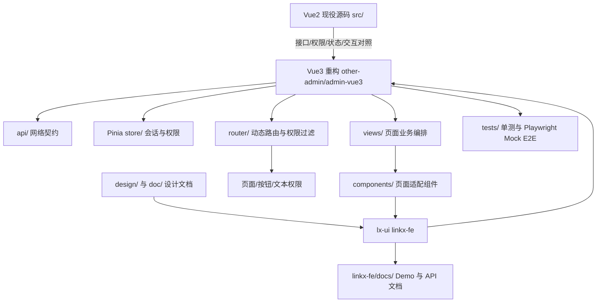

# LinkX 项目地图

## 2026-10-18 LxTag 组件门禁复核

- 组件入口 `linkx-fe/src/components/LxTag/`，中文文档 `linkx-fe/docs/components/lxtag.md`；关闭操作使用 `LxIcon`，并覆盖 small/default/large、语义色、disabled、closable 和长文本省略。
- 定向单测 **5/5**、文档 Playwright **2/2**、lx-ui 类型检查/构建/文档构建通过；修后 B 证据位于 `.impeccable/critique/lxtag-assessment-b-2026-10-18-recheck/`。
- Vue3 宿主仍保留既有 Element Plus 使用，组件级复核不等于 UI-10 全库完成；宿主迁移需保留标签语义、关闭事件和只读禁用契约。

## 2026-10-17 DynamicForm/Form Critique 归档

- 文档入口 `linkx-fe/docs/components/lxdynamicform.md`、`linkx-fe/docs/components/lxform.md` 已完成独立 A/B 证据归档；组件入口仍为 `linkx-fe/src/components/LxDynamicForm/` 与 `linkx-fe/src/components/LxForm/`，本次未改变业务 API 或宿主依赖关系。
- 两个文档 snapshot/trend 分别对应 `linkx-fe-docs-components-lxdynamicform-md` 与 `linkx-fe-docs-components-lxform-md`，综合评分 28/40；P1 横溢出和字段错误可见性已由稳定浏览器重跑关闭，剩余为文档信息密度及键盘提示观察。

## 2026-10-17 DynamicForm/Form 文档门禁阶段性复验

- 文档入口 `linkx-fe/docs/components/lxdynamicform.md`、`linkx-fe/docs/components/lxform.md`：最小配置、API 折叠和中文文档样式已调整；VitePress 构建成功，文档 Playwright **17/17**。
- 组件业务入口仍为 `linkx-fe/src/components/LxDynamicForm/`、`linkx-fe/src/components/LxForm/`；本轮只改文档展示与文档站主题，不改变组件 Props、事件、API 或宿主迁移契约。
- A **30/40** 已记录；B 因 Luna 通道 503 未形成新独立证据，不能将文档门禁映射为 UI-10/UI-11 完成。

## 2026-10-17 G2 SearchBar 与 StatusSwitch 组件门禁收口

- 入口 `linkx-fe/src/components/LxSearchBar/`：四字段标准态前三项各占 4 列，最后集成字段占 12 列；选择器与操作组桌面同排底边对齐，375px 回落为独占操作行；文档 E2E **5/5** 与单测 **10/10** 已覆盖。
- 入口 `linkx-fe/src/components/LxStatusSwitch/`：旧值映射、关闭确认竞态、只读/权限降级、HUD、窄屏和减少动效已完成；文档 E2E **4/4** 与单测 **21/21** 已覆盖。组件门禁综合收口，SearchBar A **34/40**，无开放 P0/P1。
- 两个组件不发起业务请求；Vue2 组织树、日期格式、参数协议与宿主保存 API 继续由 Vue3 适配器/页面注入。UI-10 当前 **11/52**，宿主真实替换和 Element Plus 删除仍未开始。

## 2026-10-17 预警推送 Mock 验收入口

- Vue2 对照入口为 `src/router/modules/alert.js` / `src/views/notification/alertPush/`；Vue3 实施入口为 `other-admin/admin-vue3/src/router/modules/alert.ts`、`src/views/notification/alertPush/` 与 `src/api/notification/alertPush.ts`。
- Mock E2E 位于 `other-admin/admin-vue3/tests/e2e/alert-push-workflow.spec.ts`，已验证双标签列表、筛选/重置参数、批量删除失败恢复和无人值守新增群组流程；四个表单的类型切换/API/群组名称映射已修复，编辑组合、受限账号和真实后端仍未验收。

## 2026-10-17 LxInput 复合输入高度修复

- 入口 `linkx-fe/src/components/LxInput/`，prepend/append 与输入框统一尺寸档高度，窄屏/触屏统一为 44px；E2E 断言覆盖三档桌面尺寸和 390px 触屏。
- 不增加 UI-10 完成数；组件库其余门禁、Vue3 宿主替换及 Element Plus 删除仍按交付计划执行。

## 2026-10-17 LxPageCard 正式审查

- 组件入口 `linkx-fe/src/components/LxPageCard/`，文档 `linkx-fe/docs/components/lxpagecard.md`；单测 **3/3**、文档 E2E **1/1**。
- Assessment A **33/40**；B 五视图证据有效，迁移时保留 region、`aria-busy`、loading 和具名 slots。

## 2026-10-17 LxFormErrorBanner 阶段审查

- 组件入口 `linkx-fe/src/components/LxFormErrorBanner/`，文档 `linkx-fe/docs/components/lxformerrorbanner.md`；单测 **2/2**、文档 E2E **1/1**。
- Assessment A **32/40**、B detector/浏览器证据有效；移动 overlay 的 `462/375` 命中已由无覆盖层基线归因为检测覆盖层/文档壳层，组件窄屏门禁已收口。

## 2026-10-17 LxPagination 正式审查

- 组件入口 `linkx-fe/src/components/LxPagination/`，文档 `linkx-fe/docs/components/lxpagination.md`；单测 **5/5**、文档 E2E **3/3**。
- Assessment A **32/40**；B 五视图浏览器证据和 detector 三件套有效。迁移时保留受控分页、自动重置和局部滚动。

## 2026-10-17 LxDrawer 正式审查

- 组件入口 `linkx-fe/src/components/LxDrawer/`，文档 `linkx-fe/docs/components/lxdrawer.md`；单测 **4/4**、文档 E2E **1/1**。
- Assessment A **32/40**；B 证据见 `.impeccable/critique/drawer-assessment-b-2026-10-17/`，五视图注入、主题、减少动效和窄屏证据有效。
- `closeOnPressEsc=false` 的未保存数据契约必须在宿主迁移中保留；库级审查不代表宿主替换完成。

## 2026-10-17 LxDialog 正式审查

- 组件入口 `linkx-fe/src/components/LxDialog/`，中文文档 `linkx-fe/docs/components/lxdialog.md`；组件级单测 **4/4**、文档 E2E **3/3**。
- Assessment A **28/40**；B 证据见 `.impeccable/critique/dialog-assessment-b-2026-10-17/`，五视图浏览器注入重试成功，初次 live-server 失败已单独记录。
- 当前台账保留提交中关闭、脏表单保护、长内容滚动、重复错误反馈和拖拽/标题提示等后续硬化项；库级审查通过不代表 Vue3 宿主已替换。

## 2026-10-17 LxEmpty 组件门禁

- 组件入口：`linkx-fe/src/components/LxEmpty/`；中文文档：`linkx-fe/docs/components/lxempty.md`；Vue3 使用盘点：15 处 `el-empty`，迁移契约记录在 `other-admin/admin-vue3/docs/MIGRATION-BACKLOG.md` 和 `MIGRATION-MATRIX.md`。
- 单测 **5/5**、文档 E2E **1/1**、lx-ui 类型检查通过；Assessment A **35/40**，B 证据见 `.impeccable/critique/empty-assessment-b-2026-10-17/`。
- 库级完成不代表宿主采用；逐页迁移必须保留 `description`、`imageSize`、`class`、footer 插槽和空/错/加载状态契约。

## 2026-10-16 UI-04 前置组件交接：LxSectionTitle 适配器复核

- `other-admin/admin-vue3/src/components/SectionTitle/index.vue` 已补 `subtitle` 属性/插槽透传与 `leading` 插槽优先级；映射图标和未映射图标回退不再吞掉调用方自定义前置内容。
- 库/适配器单测 **18/18**、文档 Playwright **1/1**、类型、ESLint、Prettier 和差异检查通过。Assessment B 证据 `.impeccable/critique/sectiontitle-assessment-b-2026-10-16/` 覆盖 8 个视图，页面错误、失败请求和横溢出均为 0；静态 detector 三件套为 `[]`/空/0。
- HUD 颜色与 LxTag 紧凑尺寸命中已按设计依据归类；VitePress 壳层/overlay 命中不归因组件。宿主真实业务组合、权限和后端联调仍未完成，下一入口为 G2 `LxSearchBar`/`LxStatusSwitch`。

## 2026-10-16 G2 LxSearchBar 当前修复

- `LxSearchBar` 四字段标准态为四个 `span 6` 栅格，第四列内部承载操作；`SearchBar` 适配器恢复批量 action 的 `selectedCount` 禁用和 `action` key 事件，并隐藏默认状态行。
- 库单测 **9/9**、适配器单测 **2/2**（合计定向测试 **11/11**）、文档 E2E **4/4**，类型/格式检查通过。旧 Vue2 组织树、日期格式和参数回传契约仍需按页面逐项映射，不以通用适配器冒充完成。

## 2026-10-16 UI-04 前置组件交接：LxMetricCard 趋势语义复核

- `LxMetricCard` 增加可选 `trendDirection`（`up`/`down`/`flat`），显式传值优先；未传值继续按旧 `trendStatus` 推断，保留 Vue3 宿主兼容行为。指标角标内的状态点标记为装饰性内容，避免重复读屏。
- 定向单测 **15/15**、文档 Playwright **3/3**、lx-ui 类型检查和构建、Vue3 目标格式检查通过；文档 E2E 覆盖显式上行/下行/持平趋势、旧 `error` 下行回退、进度 ARIA、320px、HUD 和减少动效。独立复跑因登录鉴权和外部代理超时阻断，已单列为环境失败。
- Assessment B 证据目录 `.impeccable/critique/metriccard-assessment-b-2026-10-16-recheck/` 已保存 detector JSON、stderr、退出码、Light/HUD 桌面与移动截图及 DOM 记录；三目标静态 `[]`、空 stderr、退出码 `0`，浏览器无页面错误或失败请求，非零命中归因于文档壳层。静态 `[]` 仅表示规则零命中。
- 本次仍不增加 UI-10 严格矩阵计数，不替换 `ClientDetailDrawer.vue` 的 6 处宿主实例，不删除 Vue3 `element-plus`；下一入口为 `LxSectionTitle`，随后按既定顺序继续基础组件和 G2 组件，页面操作引导、权限中心和字段权限保持后置。

## 2026-10-16 UI-10 / Wave 25 LxAuthImg 严格矩阵收口

- `LxAuthImg` 已修复已加载回退图复用时的错误 loading、回退图 A→B→A 迟到事件污染及显式小尺寸加载框被最小尺寸撑大的问题；组件仍由宿主注入 Blob 请求，不持有 Token 或请求库。
- 定向单测 **17/17**、文档 E2E **5/5**、lx-ui 类型检查/206 modules 构建、VitePress、Vue3 类型检查、目标格式和差异检查通过。B 路四视图 HTTP 200、注入成功、页面错误/失败请求/异常响应均为 0；静态 detector 为合法 `[]`/空 stderr/退出码 0，命中均归因文档壳层或主题规则。请求失败并显示 fallback 时的 `error-actions` 重试契约已补测。证据目录为 `.impeccable/critique/authimg-assessment-b-final-2026-10-16/`。
- 当前版独立 Assessment A 为 **37/40（Good）**，四视图页面错误与失败请求为 0；A/B 综合报告、趋势和复验材料均位于 `.impeccable/critique/authimg-assessment-b-final-2026-10-16/`，代码复审无可复现 P0–P2。UI-10 更新为 **9/52**；真实鉴权适配器、Vue3 宿主替换和全库 Element Plus 删除仍属 UI-04/全库门禁，下一入口为 `LxMetricCard` 与 `LxSectionTitle`，随后进入 G2 `LxSearchBar` 与 `LxStatusSwitch`；页面操作引导继续暂缓。

## 2026-10-15 UI-10 / Wave 24 LxActionButtons 严格矩阵关闭

- **组件库状态**：按 `design/按钮体系/` 完成 LxActionButtons 当前实现、Demo、中文 API 和权限边界严格复核。A 33/40，原显式空权限对照 P2 关闭；B 四个源码 detector 为有效 `[]`/空 stderr/退出码 0，8 个 Light/HUD × 桌面/375px 浏览器视图成功注入；独立代码复审无开放 P0–P3。
- **验证**：单测 18/18、文档 E2E 9/9、Vue3 类型/目标 ESLint、lx-ui 类型/206 模块构建、VitePress、Stylelint、Prettier 与差异检查通过。移动 overlay 注入后根文档宽增至 615px，注入前页面基线为 375px，已归因为 detector 标注副作用。
- **边界与下一入口**：UI-10 更新为 **8/52**；Vue3 29 处宿主 ActionButtons 仍待 UI-04 适配，真实权限服务未联调。下一项按矩阵进入 `LxAuthImg`；页面操作引导不进入待办或排期。
- **评审证据**：综合 snapshot `.impeccable/critique/2026-10-15T03-34-29Z__linkx-fe-src-components-lxactionbuttons-index-vue.md`；A/B 原始材料见同级 `assessment-a-actionbuttons-auth-contrast-20261015/` 与 `actionbuttons-assessment-b-final-64a2951-2026-10-15/`。

## 2026-10-15 全菜单 Mock 预览回归复验

- **入口与结果**：在 `other-admin/admin-vue3` 使用独立端口 `31853` 重跑 `playwright.preview.config.ts`，全菜单与预览 E2E **10/10 通过**；包含全部菜单首屏数据、搜索竞态、Mock CRUD、轮播分页及 AuthImg 错误恢复/键盘重试/减少动效。
- **当时边界与后续**：全部写操作由本地 Mock 接管，结果不表示真实后端联调。该次复验后的 `LxActionButtons` 矩阵核查已于 Wave 24 完成；当前下一入口见本文件顶部，进入 `LxAuthImg`。页面操作引导继续暂缓、不进入待办或排期。

## 2026-10-15 Wave 23 / LxButton Demo 键盘焦点与锚点复验

- **入口与变化**：`linkx-fe/src/components/LxButton/demo/basic.vue` 为完整演示区提供可见标题锚点，并给尺寸选择框增加 `:focus-visible` 外框；`linkx-fe/docs/components/lxbutton.md` 将演示区命名关联到该标题。
- **验证与复审**：LxButton 文档 E2E 19/19（lx-ui 专用配置、隔离端口 4177）；补充 Light/HUD 焦点颜色断言后专项回归 1/1。Prettier、目标 ESLint、差异检查通过。Impeccable A 初评 30/40，尺寸选择框 P2 经 Light/HUD × 桌面/320px 四视图复验关闭；B 三个源码检测器为有效 JSON `[]`、stderr 空、退出码 0，四个 Light/HUD × 桌面/390px 视图成功注入，无页面错误或失败请求。覆盖层命中归因为 VitePress 外壳、代码示例和 HUD 主色令牌。代码复审最终批准，无未关闭 P0–P3；正式快照见 `.impeccable/critique/2026-10-14T16-33-46Z__linkx-fe-src-components-lxbutton-index-vue.md`。静态 `[]` 不代表视觉审查通过。
- **边界与下一入口**：只修复文档演示的锚点与键盘焦点，不增加 UI-10 全库关闭数；该记录时全库为 **7/52**，当前状态见顶部 Wave 24。此项不代表宿主页面替换或真实联调。`LxInputNumber` 桌面目标尺寸 P2 等待设计决策；页面操作引导继续暂缓，不进入当前待办或排期。

## 2026-10-14 Wave 22 / LxInput UI-10 严格矩阵关闭

- **组件入口**：`linkx-fe/src/components/LxInput/`，Demo 为 `demo/basic.vue`，中文 API 为 `linkx-fe/docs/components/lxinput.md`；设计源为 `design/表单控件八件套/code.html` 第 01 区。
- **验证入口**：定向单测 13/13、共享基础控件文档 E2E 11/11、最终提示断行复验 1/1；lx-ui 类型/构建、VitePress、Vue3 类型/生产构建和目标代码质量检查通过。
- **正式评审**：Impeccable A 34/40（Good），清空入口发现性、窄屏方法区布局及提示断行 P3 均已关闭；B 三个 detector 为合法 JSON `[]`、stderr 空、退出码 0，Light/HUD × 桌面/390px 四视图注入成功；独立代码复审无 P0–P3。A/B 证据与综合 snapshot 位于 `.impeccable/critique/lxinput-wave-2026-10-14/`，趋势最近三次均为 34/40。
- **差异、边界与下一入口**：设计标本默认态清空图标常驻，当前桌面仅在有值且 hover/focus 时显示，触屏或 640px 以下有值即显示；该差异已在 API/Demo 说明。该记录时 UI-10 为 **7/52**，后续状态见顶部 Wave 24；不代表 Vue3 宿主替换、真实后端或人工读屏完成。`LxInputNumber` 桌面目标尺寸 P2 仍待设计决策。页面操作引导继续暂缓，不进入当前待办或排期。

## 2026-10-14 Wave 21 / LxTextarea UI-10 严格矩阵关闭

- **组件入口**：`linkx-fe/src/components/LxTextarea/`，Demo 为 `demo/basic.vue`，中文 API 为 `linkx-fe/docs/components/lxtextarea.md`；设计源为 `design/表单控件八件套/code.html` 第 08 区。
- **验证入口**：`other-admin/admin-vue3/tests/unit/lx-textarea.test.ts` 14/14；共享基础控件文档 E2E `tests/e2e/lx-base-controls-docs.spec.ts` 11/11，隔离端口 4179；lx-ui 类型检查、206 modules 构建、VitePress、Vue3 生产构建和定向代码质量检查通过。
- **正式评审**：Impeccable A 31/40（Good），无 P0–P3；B 两个 detector 均为合法 JSON `[]`、stderr 空、退出码 0，Light/站点深色/HUD × 桌面/移动六视图完成；独立代码复审无 P0–P3。`[]` 只表示静态规则零命中。证据见 `.impeccable/critique/lxtextarea-wave-2026-10-13/current-final/`。
- **差异、边界与下一入口**：设计稿使用 `p-2.5`（10px），实现为 8px 垂直/12px 水平令牌；约 74px 标本与实测 76px 的差异已登记，不宣称像素完全一致。UI-10 当时为 **6/52**；`LxInput` 已于 Wave 22 关闭后更新为 7/52。本波不代表 Vue3 宿主替换、真实后端或人工读屏完成。`LxInputNumber` 桌面尺寸 P2 仍待设计决策；页面操作引导暂不考虑、不继续拆分或排期，仅保留历史需求与文案草案。

## 2026-10-14 Wave 20 / LxSelect UI-10 严格矩阵关闭

- **组件入口**：`linkx-fe/src/components/LxSelect/`，Demo 为 `demo/basic.vue`，中文 API 为 `linkx-fe/docs/components/lxselect.md`；设计依据为 `design/表单控件八件套/`。
- **验证入口**：`other-admin/admin-vue3/tests/unit/lx-select.test.ts` 与 locale fallback 定向单测合计 15/15、`tests/e2e/lx-select-docs.spec.ts` 8/8、全量 Vue3 Vitest 565/565；隔离全菜单/预览 E2E 10/10。lx-ui 类型检查/构建、VitePress、Vue3 类型/生产构建及目标格式/Lint 通过；Vue3 ESLint 对库源码返回 ignored，不计作库 ESLint 通过。
- **正式评审**：双代理 Impeccable A 36/40（Excellent），无开放 P0–P2；B 四个 detector 均为有效 JSON `[]`、stderr 空、退出码 0，六个独立浏览器上下文成功注入，无页面错误、失败请求或 HTTP 错误响应。loading 有确定性 E2E 文案断言，但未取得可信的 loading 专属截图；静态 `[]` 仅代表规则零命中。
- **证据、遗留与边界**：A/B 当前源码锁与浏览器证据见 `.impeccable/critique/lxselect-final-2026-10-14-post-fix/`，综合 snapshot 为 `.impeccable/critique/2026-10-14T00-42-11Z__linkx-fe-src-components-lxselect-index-vue.md`，趋势 33/40 → 35/40 → 36/40。文档页约 10 项目录作为共享外壳 P3 后续整理；UI-10 当前 **5/52**。本波不代表 Vue3 宿主替换、真实后端联调或人工读屏完成；页面操作引导仍暂缓且不在执行队列或排期。
- **下一入口**：对已完成组件级复核、但仍未关闭全库严格矩阵的 `LxTextarea` 按 UI-10 统一门槛取证；`LxInputNumber` 桌面步进目标尺寸 P2 继续等待设计决策，不擅自改变设计稿。

## 2026-10-13 LxInputNumber 当前版审查入口

- **审查结果**：Impeccable Assessment A 为 29/40；B 的四个静态 detector 均为合法 `[]`/空 stderr/退出码 0，Light/HUD × 桌面/375px 浏览器视图均注入成功。完整归因和证据见 `.impeccable/critique/lxinputnumber-wave19-current-2026-10-13/`。
- **未关闭项**：桌面步进按钮高 13/15/19px 的 P2 尚待设计决策；`LxInputNumber` 严格矩阵行保持开放，UI-10 仍为 4/52。本轮没有产品代码改动。
- **下一入口**：`LxTextarea` 已完成当前版组件级复核；按仍未关闭的基础控件严格矩阵进入 `LxSelect` 核验，桌面目标 P2 保留跟踪。页面操作引导当前不执行、不纳入待办或排期，后续有需要时再由用户提出并重新评估。

## 2026-10-13 Wave 19 / Checkbox 与 Radio 四项 UI-10 严格矩阵登记

- **组件与设计源**：`LxCheckbox`、`LxCheckboxGroup`、`LxRadio`、`LxRadioGroup` 对照 `design/表单控件八件套/screen.png` 与 `code.html` 第 03/04 区；组件矩阵记录了尺寸/间距、主题令牌、交互差异和不适用状态。
- **验证与审查**：单测 23/23、文档 E2E 16/16；lx-ui 类型检查/构建、VitePress、Vue3 类型检查、目标格式/Lint 通过。Impeccable A 36/40；B 8 个 detector 为合法 `[]`/空 stderr/退出码 0，8 个 Light/HUD × 桌面/375px 视图注入成功；独立代码复审关闭空错误断言 P2。
- **证据与边界**：报告和浏览器原始证据在 `.impeccable/critique/checkbox-radio-component-final-2026-10-13/`，正式快照在 `.impeccable/critique/2026-10-13T09-44-41Z__linkx-fe-src-components-lxcheckbox-index-vue.md`。UI-10 当前 **4/52**；不代表 Vue3 宿主替换、真实后端联调或全库门禁完成。两个非阻塞共享文档 P3 留在审计记录中。
- **下一入口**：`doc/lx-ui/COMPONENT-AUDIT.md` 中 `LxInputNumber` 桌面步进目标尺寸 P2 已于 2026-10-13 完成本轮复核但仍未关闭；`LxTextarea` 已完成组件级复核，下一项为尚未关闭严格矩阵行的 `LxSelect`。页面操作引导当前不执行、不纳入待办或排期。

## 2026-10-13 Wave 18 / Checkbox 与 Radio 当前版复核及文档窄屏 P2 收口

- **组件与 Demo**：`LxCheckbox`、`LxCheckboxGroup`、`LxRadio`、`LxRadioGroup` 的样式和中文文档按设计稿复核。Checkbox Demo 分开知情确认/通知渠道并演示必填校验；Radio Demo 独立展示只读历史快照并演示必填校验。
- **响应式表格**：`useResponsiveDocTable(24)` 在明显溢出时提供横向提示、键盘滚动和固定首列；7 张表启用，3 张短溢出表保持非焦点停靠。长 `disabled` 说明移入折叠详情，摘要至少 44px 并显示品牌色焦点环。
- **入口与验证**：定向单测 23/23、当前文档 E2E 16/16；lx-ui 类型检查、206 modules 构建、VitePress、Vue3 类型检查、目标 Prettier、E2E 文件 ESLint 和差异检查通过。Vue3 ESLint 忽略 `linkx-fe` 组件源码，未计为组件库 ESLint 通过。
- **正式复核**：最终全量 Assessment A 36/40（Excellent），两个组件示例分组 P3 已在 Light/HUD 桌面及 375px 复验关闭，无开放 P0–P2。B 的 8 个静态目标均为合法 `[]`/空 stderr/退出码 0，8 个新页面上下文无页面错误和失败请求；Radio HUD 两条命中符合主色令牌，移动根宽变化发生在 overlay 注入之后。真实 `LxForm` 空错误节点探针验证隐藏、零高度和无伪元素，16 条文档 E2E 全部通过；代码复审关闭空数组断言 P2。桌面文档导航密度和未来可编辑表格方向键处理作为共享文档 helper 的非阻塞 P3 单独跟踪。
- **后续 P3**：桌面 VitePress 组件页导航同时展示约 8–10 个同级锚点；作为共享文档外壳的信息架构事项单独评估，不归为组件缺陷，不阻塞本波。
- **证据与边界**：当前 A/B、代码复审、截图、源码指纹与综合报告见 `.impeccable/critique/checkbox-radio-component-final-2026-10-13/`；旧版文档 P2 的 8/8、六视图仅作历史记录。当前变更不关闭四个组件的 UI-10 严格矩阵行，全库仍为 0/52，也不代表 Vue3 宿主替换或 Element Plus 移除。页面操作引导当前不执行、不纳入待办或排期；后续明确有需要时再重新纳入计划。
- **下一步**：按 `doc/lx-ui/COMPONENT-AUDIT.md` 补齐四个组件尚未关闭的严格矩阵证据，再继续基础控件、动态图标、`LxDynamicForm` 和 Vue3 Element Plus 替换。

## 2026-10-13 Wave 17 / LxSelect 当前版组件级复核完成

- **组件入口**：`linkx-fe/src/components/LxSelect/`，Demo 为 `demo/basic.vue`，中文 API 为 `linkx-fe/docs/components/lxselect.md`；设计依据为 `design/表单控件八件套/`。
- **验证入口**：`other-admin/admin-vue3/tests/unit/lx-select.test.ts`（11/11）及 `tests/e2e/lx-select-docs.spec.ts`（3/3）；定向 ESLint、Prettier、`git diff --check` 复验通过。lx-ui 类型检查、206 modules 构建、VitePress 文档构建与 Vue3 生产构建在实现阶段通过。
- **正式评审**：Impeccable Assessment A 33/40（Good），无 P0–P3；B 的两个 detector 为合法 JSON `[]`、stderr 空、退出码 0，Light/HUD 桌面与窄屏、站点深色桌面五种状态均成功注入且浏览器错误为 0。独立代码复审无 P0–P3。
- **命中归因与边界**：overlay 命中主要落在文档段落、API 表格、代码复制控件与站点外壳；Select 标签/选项命中已按设计令牌、对比度和实际显示逐项核对。移动根宽度 390px → 630px 仅发生于 overlay 注入后，body 与 Demo 尺寸不变，注入前无溢出。完整报告、截图、指纹与 snapshot/trend 见 `.impeccable/critique/lxselect-wave-2026-10-13/`。
- **下一入口与完成口径**：先处理 `LxCheckbox`/`LxCheckboxGroup`、`LxRadio`/`LxRadioGroup` 的 375px API 表格可读性 P2，再继续基础控件和动态图标，随后 `LxDynamicForm` 及剩余 lx-ui 门禁。UI-10 全库仍为 0/52；本波不代表 Vue3 Element Plus 替换或真实后端联调。页面操作引导当前不考虑、不纳入队列或排期。

## 2026-10-13 Wave 16 / LxTextarea 当前版组件级复核完成

- **组件入口**：`linkx-fe/src/components/LxTextarea/`，Demo 为 `demo/basic.vue`，中文 API 为 `linkx-fe/docs/components/lxtextarea.md`；设计依据为 `design/表单控件八件套/`。
- **验证入口**：`other-admin/admin-vue3/tests/unit/lx-textarea.test.ts`（14/14）与 `tests/e2e/lx-base-controls-docs.spec.ts`（11/11，共享基础控件文档回归）；lx-ui 类型检查、206 modules 构建、VitePress、Vue3 生产构建和定向代码质量检查通过。
- **正式评审**：Impeccable Assessment A 31/40（Good），未发现 P0–P3；B 对组件与 Demo 的 detector 均为合法 JSON `[]`、stderr 空、退出码 0，六个 Light/站点深色/HUD × 桌面/移动视图均成功注入。初始到限/超限静默、正常状态转到限/超限仅播报一次；禁用/只读校验状态隐藏计数且保留错误说明。独立代码审查无 P0–P3。
- **Overlay 归因与边界**：移动根文档宽度 390px → 630px 仅发生在 overlay 注入后；注入前及无 overlay 的 320/375px E2E 无横向溢出，组件 Demo 宽度不变，归为检测覆盖层/页面外壳副作用。未执行 NVDA/VoiceOver 人工读屏。只关闭组件级审查，不增加 UI-10 全库 0/52 口径，也不代表 Vue3 宿主替换。
- **下一入口**：本条交接时的下一项 `LxSelect` 已于 Wave 17 收口；随后先处理 Checkbox/Radio 文档 375px API 表格可读性 P2，再继续其他基础控件和动态图标、`LxDynamicForm` 与其余 lx-ui 组件。页面操作引导当前不考虑、不纳入队列或排期，后续有需要时再重新评估。

## 2026-10-12 Wave 14 / LxInput 当前版组件级复核完成

- **组件入口**：`linkx-fe/src/components/LxInput/`，Demo 为 `demo/basic.vue`，中文 API 为 `linkx-fe/docs/components/lxinput.md`；设计依据为 `design/表单控件八件套/`。
- **验证入口**：`other-admin/admin-vue3/tests/unit/lx-input.test.ts`（13/13，含父级表单禁用、显式禁用和只读清空）与 `tests/e2e/lx-base-controls-docs.spec.ts` 中 LxInput 用例（3/3）及邻接 InputNumber 用例（1/1）。共享基础控件 E2E 全量为 6/8，两个既有标签断言失配详见交接记录。lx-ui 类型检查、205 个模块的构建、VitePress 构建、Vue3 类型检查、目标 ESLint/Prettier 与差异检查通过。
- **复核结论**：当前版 Assessment A 34/40（Good），未发现 P0–P2；组件与 Demo detector 为合法 JSON `[]`、stderr 空、退出码 0。Light/HUD × 1440/390px 四视图均成功注入，错误对比度、44px 触控目标、`inputmode=tel`、键盘清空与表单禁用继承通过。
- **Overlay 归因**：行长命中落在文档正文和 Demo 说明，移动裁切命中为 VitePress 导航，遮罩命中为代码块复制控件；未命中输入框。注入标记使文档宽度扩张，注入前页面无横向溢出。综合报告、snapshot/trend 和证据见 `.impeccable/critique/lxinput-wave-2026-10-12/`。
- **遗留建议**：codeview 无 P0–P2；联系电话计数和窄屏工具栏键盘焦点两项 P3 测试增强继续登记，不阻塞下一波。
- **边界与下一步**：不增加 UI-10 全库矩阵关闭数，不代表宿主表单或 Vue3 Element Plus 替换完成。下一基础控件为 `LxInputNumber`。页面操作引导当前暂不考虑、不纳入执行队列或排期；后续有需要时再重新评估。

## 2026-10-12 Wave 13 / LxButton 当前版正式收口

- **组件入口**：`linkx-fe/src/components/LxButton/`，Demo 为 `demo/basic.vue`，中文 API 为 `linkx-fe/docs/components/lxbutton.md`；按钮令牌位于 `linkx-fe/src/tokens/` 与 `linkx-fe/src/styles/`，设计依据为 `design/按钮体系/DESIGN.md`。
- **回归入口**：`other-admin/admin-vue3/tests/unit/lx-button.test.ts`（33/33）与 `tests/e2e/lx-button-docs.spec.ts`（19/19）；E2E 使用 `playwright.lxui.config.ts`、Mock 后端和隔离浏览器文档站。
- **构建验证**：lx-ui `vue-tsc --noEmit`、205 modules 构建、VitePress 文档构建、目标 ESLint/Prettier 与 `git diff --check` 通过。`md` 字号为 14px；Tooltip 关闭 Element Plus 默认淡入淡出；单测覆盖触摸/键盘聚焦，多视图 E2E 覆盖提示互斥和触屏点击。
- **评审状态**：当前冻结版 Assessment A、Assessment B（detector/浏览器）及代码复审已完成，正式报告与 snapshot/trend 已保存；静态 detector `[]` 不能单独作为视觉通过证据。
- **边界**：本波只处理组件库，不代表 Vue3 业务页全面使用 LxButton，不增加 UI-10 全库完成数，也不引入按钮权限或真实后端请求。

## 2026-10-11 Wave 11 / LxDescriptions 当前版正式复核

- **组件入口**：`linkx-fe/src/components/LxDescriptions/`；Demo 为 `demo/basic.vue`，中文文档为 `linkx-fe/docs/components/lxdescriptions.md`。文档表格响应式逻辑位于 `docs/.vitepress/theme/useResponsiveDocTable.ts`，共享样式位于 `custom.css`。
- **验证入口**：`other-admin/admin-vue3/tests/unit/lx-descriptions.test.ts`（9/9）与 `tests/e2e/lx-descriptions-docs.spec.ts`（3/3）；lx-ui 类型检查、203 modules 构建、VitePress 构建和目标格式检查通过。
- **Impeccable 证据**：A 原始 4.1/5，综合按 0-4 口径 31/40；B 42/42 浏览器样本、当前 detector 三件套 `[]`/空 stderr/exit 0、目标指纹闭环；正式报告与快照见 `.impeccable/critique/descriptions-wave-2026-10-11/`。
- **边界**：组件不请求 API、不读取权限或 Pinia；宿主真实数据、权限、读屏器、后端联调和 Vue3 Element Plus 替换仍归 UI-04/UI-10，不能由组件级 Critique 代替。

## 2026-10-11 UI-10 / Wave 12 LxMetricCard 与 LxSectionTitle

- **组件入口**：`linkx-fe/src/components/LxMetricCard/` 与 `LxSectionTitle/`；设计源为 `design/指标卡 MetricCard/`、`design/区块标题 SectionTitle/`；中文 API 位于 `linkx-fe/docs/components/lxmetriccard.md`、`lxsectiontitle.md`。
- **宿主入口**：`other-admin/admin-vue3/src/components/SectionTitle/index.vue` 已透传 `headingLevel`、`size`、`tag`、`tagType`；`ClientDetailDrawer.vue` 的 6 处 MetricCard 仍在 UI-04 逐页迁移清单中。
- **验证入口**：`tests/unit/lx-metric-card.test.ts`、`lx-section-title.test.ts`、`lx-tag.test.ts`、`section-title-adapter.test.ts`；文档 E2E 为对应 MetricCard/SectionTitle 规格页。
- **证据关系**：综合报告 `.impeccable/critique/metric-section-wave-2026-10-11/final-report.md`；A/B/代码复审证据在同目录。公共类型 `LxSectionTitleHeadingLevel` 已从 `linkx-fe/src/index.ts` 导出。
- **边界**：组件库不请求 API、不持有权限；业务保存、权限状态和真实数据由宿主提供。当前 UI-10 全库仍开放，Vue3 `element-plus` 仍保留。

## 2026-10-11 Wave 11 / LxVirtualTree 插槽布局与 TransferPanel 联回归完成

- `LxVirtualTree` 已公开 `rowLayout`（`single`/`stacked`/`responsive`）和 `nodeSummary`，同步导出插槽 scope 类型；固定行高、虚拟窗口、滚动定位和焦点恢复使用同一行几何。节点插槽明确为展示型元信息，不承载按钮或链接。
- `LxTransferPanel` 使用公开行布局契约，树行不再由宿主 `:deep` 改写；窄屏长名称提供可键盘操作的“查看全文/收起”。Demo 高级操作分为数据定位与边界外观两级。
- 证据：定向单测 **67/67**、VirtualTree 文档 E2E **14/14**、TransferPanel 文档 E2E **33/33**；lx-ui 类型/203 modules 构建、VitePress、Vue3 生产构建、目标格式/Lint 和差异检查通过。A **31/40**；B 四个 detector 目标均为有效 `[]`/空 stderr/exit 0，六视图 overlay/键盘/长筛选证据齐备；代码复审批准，无 P0-P3。完整证据见 `.impeccable/critique/lxvirtualtree-wave11-2026-10-11/`。
- 窄屏选中列表首屏密度、批量动作层级和 Demo 控制密度列后续 P2；`nodeSummary` 是多行插槽在固定行虚拟化下的完整可访问摘要。UI-10 仍 `0/52`，Vue3 `element-plus` 删除、权限宿主和真实联调继续后置。

## 2026-10-11 Wave 11 / LxDescriptions Demo 控件密度阶段性收口

- Demo 控件区新增“布局”组名，数据状态改用带标签的 `LxSelect`，保留边框和 HUD 开关；对应 E2E 增加分组、边框生效、375/320px 无溢出和键盘状态切换断言。
- `lx-descriptions.test.ts` 6/6、文档 E2E 3/3、`linkx-fe` 类型检查、目标 Prettier、修后代码复审和 `git diff --check` 通过。业务 API、路由、权限键和 Vue3 宿主未修改。
- Assessment A 为 31/40（Good），Assessment B 三个 detector 为有效 `[]`/空 stderr/exit 0；Edge 新 profile 启动失败，overlay 未注入，因此本波是阶段性 Critique，不能记为正式视觉通过。A/B/代码复审与 snapshot/trend 见 `.impeccable/critique/lxdescriptions-p2-2026-10-11/` 和 `.impeccable/critique/2026-10-10T18-32-43Z__kx-fe-src-components-lxdescriptions-demo-basic-vue.md`。
- 下一入口为当前版 `LxVirtualTree` 固定插槽行高、长文本/块级插槽、滚动偏移和焦点恢复回归，并联跑 TransferPanel；UI-10 全库矩阵、Vue3 `element-plus` 删除、权限宿主和真实联调继续开放。

## 2026-10-11 Wave 10 / TransferPanel 选择框与桌面行密度复验完成

- `LxVirtualTree` 和 TransferPanel 页脚复选框的可见框统一锁定为 14×14px。树节点控制区桌面为 24×24px、窄屏为 44×44px；页脚使用 `LxCheckbox` 标签点击区，桌面最小高度为 32px、无悬停设备为 44px，宽度随标签内容变化。
- 修复已合入 `ad797971`。修后桌面树行编码/状态可在列宽内收缩，Demo 折叠摘要显示数据状态和主题；TransferPanel 文档 E2E `33/33`、`linkx-fe` 类型检查、203 模块构建、VitePress 文档构建和目标 ESLint/Prettier 通过。
- 修前 A 的桌面行溢出观察由浏览器证据确认并处理；320px 拥挤观察经 DOM 和截图证实为误报，移除 overlay 注入节点后页面基线宽度恢复。改后 A **35/40**；B 三 detector 为有效 `[]`/空 stderr/exit 0，浏览器 overlay/主题/视口证据齐全；代码复审无 P0–P3。综合报告、非空 snapshot/trend 位于 `.impeccable/critique/transferpanel-final-2026-10-11/` 与根目录 snapshot。
- 宿主保存状态归 UI-04；元信息字号与触屏长编码查看列入 VirtualTree 复验。下一步先处理 `LxDescriptions` Demo 控件密度 P2，再审当前版 VirtualTree 固定插槽行高和 TransferPanel 联回归；UI-10 仍不因本轮关闭全库 52 项矩阵。

## 2026-10-10 Wave 9 / LxUpload 回灌 abort 回归完成

- `other-admin/admin-vue3/tests/unit/lx-upload.test.ts` 已覆盖 fallback UID 生成后父级回灌，再由公开 `abort()` 取消和复位；单测 38/38 通过。
- Upload 文档 E2E 合计 9/9：7 项批量运行通过，服务中途断开的 2 项已独立重跑通过；环境记录见 `.impeccable/critique/wave9-upload-2026-10-10/agent-notes.md`。
- 下一地图入口：`LxDescriptions`、`LxVirtualTree` 当前版正式 A/B、浏览器证据和代码复审；真实上传协议仍属 UI-04。

## 2026-10-10 G2 正式收口组件入口

- SearchBar Demo 现在同时展示四字段标准态和多字段折叠态；StatusSwitch 现在覆盖确认影响/审计上下文及所有状态行的 ARIA 关联。
- 修后定向单测 `26/26`，SearchBar E2E `3/3`、StatusSwitch E2E `4/4`，Assessment A/B 浏览器与 detector 证据已保存；综合报告见 `.impeccable/critique/g2-complete-2026-10-10/recheck-final/report.md`，两个目标 snapshot/trend 均已写入并返回 `39/40` 非空记录，代码复审无 P0-P2。当前先修复 TransferPanel 选择框尺寸反馈，再进入 `LxDescriptions`、`LxVirtualTree`。

## 2026-10-10 G2 组件入口（历史记录，阶段性/降级未正式完成）

- `linkx-fe/src/components/LxSearchBar/`：已完成搜索区域语义、loading/折叠字段提示、移动触控和减少动效修复；单测 8/8、文档 E2E 3/3。G2 Assessment A 为浏览器不可启动的降级评审，31/40（Good）；B 的 detector `[]`/空 stderr/exit 0 仅代表静态规则零命中，浏览器截图/DOM 已保存但 overlay 注入未稳定完成。
- `linkx-fe/src/components/LxStatusSwitch/`：已完成确认竞态、外部 modelValue/权限源变化、loading/只读 ARIA 和键盘回归；单测 14/14、文档 E2E 3/3，G2 合并 E2E 6/6。
- 上述为历史阶段性记录；正式复验已补齐四字段同行、确认上下文、ARIA、HUD/Teleport、375px 无溢出、减少动效和 overlay 证据。detector `[]` 仅代表静态零命中，正式结论依赖完整 A/B、浏览器证据、stderr、退出码与 snapshot/trend。
- 375px 文档页整体横向宽度 615px 目前归因于 API 表格/代码区域；组件自身无溢出，但仍需在可启动浏览器中完成复杂状态实图复验。UI-10 仍为 0/52，Vue3 Element Plus 宿主替换继续后置。

## 2026-10-10 Wave 7 已收口 / G2 启动

- `LxTransferPanel` 当前版已冻结：文档 Demo 最大 820px 居中，组件 API 默认 `panelHeight=380px`；窄屏长名称两行折叠、展开全文、筛选隐藏恢复、列表滚动边界和 44×44px 移除目标均有回归。
- 证据：定向单测 64/64、TransferPanel 文档 E2E 32/32；lx-ui 类型/203 模块构建、VitePress 文档构建、Vue3 生产构建通过。Impeccable A 32/40；B 三 detector 为有效 `[]`/空 stderr/exit 0，六组浅色/HUD 浏览器证据和代码复审已归档。
- 交接：综合报告位于 `.impeccable/critique/wave7-transferpanel-2026-10-09/final-density-61/final-report.md`，正式快照位于 `.impeccable/critique/2026-10-09T16-43-08Z__linkx-fe-src-components-lxtransferpanel-index-vue.md`。UI-10 保持 0/52，Vue3 `DataPermissionTree` 宿主替换和真实权限联调仍在 UI-04。
- 当前入口：G2 `LxSearchBar` + `LxStatusSwitch`；先完成组件库严格设计、行为、Mock、浏览器、代码复审和 A/B，再进入宿主替换。

## 2026-10-09 Wave 7 / LxTransferPanel 820px 预览复验

- **当前展示**：组件 API 默认面板高 `380px`；文档 Demo 预览限宽 `820px`、居中，窄屏铺满正文可用宽度。`240px` 紧凑高度保留为默认，选择器常显于示例上方，并提供 `300px`/`380px` 档位。
- **评审建议处理**：窄屏数量标签及无障碍名称改为“待选”；组件文档在交互示例旁提示本地选择不代表已保存权限。真实保存状态仍由 UI-04 宿主按 dirty 状态和接口结果驱动。
- **验证**：定向单测 **64/64**，TransferPanel 文档 Playwright **30/30**；E2E 比较 1440px 下 820px 居中以及 390px 下组件与正文实际可用宽度，并检查页面无横向溢出。lx-ui/Vue3 类型检查、目标 Prettier、203 模块库构建、Vue3 生产构建通过；文档构建、最终 A/B 和 snapshot/trend 收口中。
- **审查状态与边界**：Luna 代码复审未发现 P0-P2，剩余 P3 为最新交接记录中的旧计数/哈希，本次同步修正。UI-10 保持 0/52；`DataPermissionTree` 替换及真实权限联调仍属 UI-04。本节取代下方 2026-10-08 的中间状态记录。

## 2026-10-08 Wave 7 / LxTransferPanel 最终复审进行中

- **入口**：`linkx-fe/src/components/LxTransferPanel/`、`linkx-fe/docs/components/lxtransferpanel.md`；行为回归和文档浏览器测试位于 Vue3 `tests/unit/lx-transfer-panel.test.ts`、`tests/e2e/lx-transfer-panel-docs.spec.ts`。设计基线为 `design/虚拟滚动树 + 双栏穿梭/code.html`。
- **完成**：实现 5:2:5 与 380px 同高面板、名称/部门编码联合筛选、筛选结果批量操作、节点元数据、树外已选项快照、未加载节点确认边界和 `LxVirtualTree.filterMethod(node, keyword)`。`panelHeight` 默认 380px、最小 240px，非有限值回退为 380px；桌面树项基准行高为 32px，普通短名称保持约 32px 紧凑单行，名称省略且编码/状态同行，未加载项标记与原始键值在名称下第二行，实际截断的长名称才提供 disclosure。TransferPanel 在 320–420px 窄屏为 64px、421px 起为 44px，VirtualTree 窄屏行高为 44px；窄屏控件触控区为 44×44px。树节点总量标注文义清晰，窄屏名称完整换行。
- **修复**：确认版本仅对键序列变化递增；删除未加载项后焦点回落至相邻项，列表为空时聚焦列表；滚动提示通过 `aria-describedby` 关联并作礼貌播报；虚拟滚动卸载焦点行后保留 Tab 停靠项；视口切回桌面时移动焦点不落在隐藏切换按钮。
- **验证**：`lx-transfer-panel.test.ts` 与 `lx-virtual-tree.test.ts` 合计 **64/64**，`lx-transfer-panel-docs.spec.ts` **28/28**；VirtualTree 文档 E2E 的 13 项单独统计。lx-ui 类型检查、203 模块构建、VitePress 文档构建、目标 Prettier/ESLint 和 `git diff --check` 通过。VitePress 375px 取证中的 615px 整页宽度只出现在 detector overlay 注入后；无 overlay 基线与组件均不横向溢出，API 宽表自身滚动回归已通过。
- **审查状态**：较新复审的问题已补实现和直接回归；Assessment B 浏览器证据已完成 **20/20**，正在收口证据索引及综合 snapshot/trend，独立代码复审、Assessment A 和综合结论尚待完成，不标记正式通过。UI-10 仍为 0/52；`DataPermissionTree` 与真实保存状态反馈属于 UI-04，真实权限/后端联调须依据真实契约。
- **下一入口**：完成本轮独立复审及两笔白名单提交推送后进入 G2 `LxSearchBar` + `LxStatusSwitch`；宿主持久化显示继续列入 UI-04，保留 Vue3 `element-plus`。

## 2026-10-07 UI-13 / Wave 6 组件级正式验收

- **入口**：`linkx-fe/src/components/LxCascader/`、`LxDescriptions/`、`LxVirtualTree/`，文档侧栏配置位于 `linkx-fe/docs/.vitepress/config.ts`；行为回归位于 Vue3 `tests/unit/lx-virtual-tree.test.ts`、`lx-descriptions.test.ts` 及对应文档 E2E。
- **完成**：当前源码已通过 Cascader HUD 弹层、Descriptions 术语、VirtualTree 键盘/混合勾选/键碰撞/空键焦点和移动控件修复，中文文档与 E2E 同步。
- **证据**：全量 Vitest 58/457；VirtualTree 18/18、Descriptions 6/6；文档 E2E 6/6；lx-ui 类型/库构建/文档构建和 Vue3 类型检查通过。A 35/40；B 7 个 detector 为有效 `[]`/空 stderr/exit 0，并完成四页浏览器 overlay 取证；代码复审批准。正式报告和原始证据见 `.impeccable/critique/wave6-descriptions-virtualtree-2026-10-07/`。
- **边界**：`[]` 不等于视觉通过；Assessment B 使用隔离 Playwright fallback。Demo 控制密度、VirtualTree 插槽高度、Cascader loading 文案列入后续 P2/P3。全库 52 项严格矩阵、Vue3 `DataPermissionTree` 宿主替换和真实权限联调仍未完成。
- **下一入口**：已转入 Wave 7 `LxTransferPanel`；当前组件级实现和行为回归完成，最终 Impeccable A/B 收口中。完成后进入 G2 `LxSearchBar` + `LxStatusSwitch`，随后再做 Vue3 `DataPermissionTree` 宿主契约回归。

## 2026-10-07 UI-13 / Wave 5 选择器组件验收

- **入口**：`linkx-fe/src/components/LxTreeSelect/`、`LxCascader/`、`LxSelectPagination/`；测试为 Vue3 `tests/unit/lx-select-pagination.test.ts` 及三份文档 E2E。
- **完成**：当前版本已覆盖键盘、清空、错误焦点、英文 locale、窄屏触控、表单禁用继承、迟到响应隔离、续页失败重试和禁用不请求；三份中文文档加入组件选型。
- **证据**：定向单测 36/36、文档 E2E 15/15、lx-ui typecheck/build/docs build、目标 ESLint/Prettier 和 `git diff --check` 通过。Impeccable A 32/40；B 9 个 detector 为有效 `[]`/空 stderr/exit 0，9 个独立浏览器 overlay 场景成功；代码复审无 P0–P2。
- **未关闭**：A 保留移动 Cascader 换行密度、Cascader 错误旧状态、Demo 主题入口和文档侧栏密度四项 P2；P3 长节点 E2E 覆盖增强。上述结果不增加 UI-10 52 项严格关闭数，也不代表 Vue3 页面已替换 Element Plus。
- **下一入口**：完成两笔白名单提交推送后，进入复杂组件批次（Upload 组合 abort 回归、Descriptions、VirtualTree、TransferPanel、MetricCard、SectionTitle、StatusSwitch、SearchBar），继续按组件库优先、宿主替换后置的顺序推进。

## 2026-10-07 UI-13 / DynamicForm、DatePicker 与 Upload 正式验收

- **入口**：schema 字段分发位于 `linkx-fe/src/components/LxDynamicForm/`，上传行为位于 `LxUpload/`，日期清空类型位于 `LxDatePicker/types.ts`；对应回归是 Vue3 `tests/unit/lx-dynamic-form.test.ts`、`lx-upload.test.ts`、`lx-date-picker.test.ts` 和三份文档 E2E。
- **修复**：Upload 模板根节点 ref 以运行时 DOM 守卫处理跨 Vue 类型边界；上传必填错误关联验证实际 `.el-upload[role="button"]`。`LxFormItem` 排除已卸载错误节点对应的内部 ID，并幂等恢复 ARIA 属性；新增同批次移除反馈/清校验回归。字段类型 E2E 逐类验证精确候选集合。
- **验证**：定向单测 **89/89**、三份文档 E2E 合并 **43/43**，最新 DatePicker/Upload 子集 **31/31**；Vue3 与 lx-ui 类型检查、目标 ESLint/Prettier、203 模块生产构建、文档构建和差异检查通过。文档构建保留既有大 chunk 警告。
- **E2E 配置**：4176 被另一项目占用并导致首次误测错误站点；lx-ui 文档测试已隔离到 4177，Switch 兼容用例另跑 6/6。4174 预览未受影响。
- **代码复审与状态边界**：独立复审未发现 P0–P2；短视口触发器与滚动断言的 P3 缺口已补。fallback UID 回灌后公开 `abort()` 的组合测试尚缺，列入后续 Upload 复验。Assessment A 为 30/40，B 六项目标 detector 均为有效 `[]`、stderr 空、退出码 0，10 个浏览器 overlay 场景已逐项归因；snapshot 已保存，trend 仅有首次 30/40 记录。实现提交为 `a2ba943`。真实上传服务端契约、`LxForm` 设计逐项对照和 UI-10 严格矩阵关闭数不包含在本次组件级验证中。
- **下一入口**：提交推送后进入 TreeSelect/Cascader 当前版本的键盘/触控与正式视觉复核，及 `LxSelectPagination` 表单禁用继承、迟到响应、续页失败同页重试与禁用不请求覆盖。

## 2026-10-06 UI-13 / Upload 跨实例 UID 复审修复

- **问题与入口**：独立代码复审确认 `linkx-fe/src/components/LxUpload/index.vue` 中回退 UID 前缀曾按组件实例重复计数，聚合多个上传字段时相同无 UID 文件可能重号；前缀生成现位于 `LxUpload/uid.ts` 模块级工厂。
- **回归入口**：`other-admin/admin-vue3/tests/unit/lx-upload.test.ts` 新增同一父组件两个 Upload 实例的相同文件回归；DatePicker、DynamicForm、Upload 单测合计 69/69 通过。
- **交付边界**：本次不修改业务 API、路由、权限、上传协议或 Vue3 页面；13 项文档 E2E 为修复前已通过结果，提交前需针对最终源码复跑。
- **评审状态**：先前 A/B 使用了不同源码冻结，且 B 浏览器只完成部分场景，不能作为正式 Critique。统一冻结后的新 A/B 尚待完成；详细记录见最新 `doc/PROJECT-HANDOFF.md` 与 `.impeccable/critique/wave4-dynamicform-2026-10-06/`。

## 2026-10-06 UI-13 / DynamicForm 与 Upload 当前交接

- **入口**：`linkx-fe/src/components/LxDynamicForm/` 按 schema 类型拆分字段渲染器；上传通用行为在 `linkx-fe/src/components/LxUpload/`；中文 API/Demo 位于 `linkx-fe/docs/components/lxdynamicform.md` 与 `lxupload.md`。
- **本轮边界**：修正受控上传重试时序、单/多文件值回映、URL/response/error 回灌和日期范围定位；Vue3 侧只增加组件级单测与文档 E2E，不改业务 API、路由、权限或页面，也未移除宿主 Element Plus。
- **验证**：DatePicker/DynamicForm/Upload 定向单测 69/69、fallback UID 修复后文档 Playwright 13/13；lx-ui 类型检查、目标 Prettier、Vue3 ESLint 通过。生产库构建和文档构建待本轮补跑。独立代码复审提出的 UID 问题已修复，修后复审与统一冻结后的正式 Impeccable A/B、snapshot/trend 尚待完成。
- **边界与下一步**：本轮组件集成验收不关闭 `LxForm`/`LxDynamicForm` 的完整设计图逐项差异记录，不增加 52 项 UI-10 严格矩阵关闭数，不代表 Vue3 业务页采用或真实上传协议联调。继续计划中的 TreeSelect/Cascader 当前版本正式复验，再按组件矩阵逐项完成库级门禁；Vue3 全量替换仍冻结。

## 2026-10-06 Wave 3 / LxIcon 当前交接

- **入口**：运行时组件 `linkx-fe/src/components/LxIcon/index.vue` 与 `icons.ts`；侧栏点位在 `linkx-fe/src/components/LxSidebar/`，上传状态图标在 `linkx-fe/src/components/LxUpload/index.vue`；中文目录为 `linkx-fe/docs/components/lxicons.md`。
- **回归关系**：`other-admin/admin-vue3/tests/unit/lx-icon.test.ts` 验证图标名称、别名、畸形/未知运行时输入和侧栏回退；`tests/e2e/lx-icon-docs.spec.ts` 验证文档搜索、复制、主题、键盘、移动触控和减少动效。
- **本轮闭环**：未知图标提供可访问回退；侧栏先解析图标键；目录具备语义搜索、清除回焦和权限节点业务样例；搜索栏不再遮挡滚动内容。
- **证据**：单测 7/7、当前 Playwright 配置 E2E 2/2（单 Chromium 项目，另有独立浏览器视图覆盖 375px）；Vue3/lx-ui 类型检查、目标 ESLint/Prettier、196 模块库构建、文档构建及 `git diff --check` 通过。修后 Assessment A 为 37/40；B 两个静态目标均为有效 `[]`/空 stderr/退出码 0，并完成五个浏览器 overlay 视图。正式报告和 snapshot 分别见 `.impeccable/critique/wave3-lxicon-2026-10-06/final-report.md` 与 `.impeccable/critique/2026-10-06T02-52-50Z__linkx-fe-docs-components-lxicons-md.md`。
- **边界与下一步**：展开 P1/P2 长分组仍保留 P2；真实读屏器播报、真实权限菜单异常数据和无 URL console 404 未覆盖/归因。不给 52 项矩阵增加关闭数。DynamicForm/Upload 后续组件级验收见本文件顶部；接下来按任务拆分进入 TreeSelect/Cascader 当前版本正式复验，Vue3 Element Plus 替换门槛不变。

## 2026-10-06 Wave 1 / LxPasswordInput 当前交接

- **入口**：组件与主题样式在 `linkx-fe/src/components/LxPasswordInput/`、`linkx-fe/docs/.vitepress/theme/custom.css`；中文 API/Demo 位于 `linkx-fe/docs/components/lxpasswordinput.md` 和组件 Demo；回归在 `other-admin/admin-vue3/tests/unit/lx-password-input.test.ts` 与 `tests/e2e/lx-password-input-docs.spec.ts`。
- **本轮闭环**：320px 真正的移动页内目录锚点避开导航；暗色站点主题延伸到 Demo 输入面；移动工具标签及高级标签为 44px。9 项浏览器 E2E 覆盖锚点、暗色/HUD、显隐、键盘、焦点、清空、只读/禁用和减少动效。
- **代码与视觉证据**：单测 10/10；A 32/40；B detector 目标 3/3 有效 `[]`、空 stderr、退出码 0；overlay 11 个节点归因为 HUD 主题规则和文档壳层。独立代码复审批准。完整资料见 `.impeccable/critique/wave1-lxpasswordinput-2026-10-05/final-recheck-2026-10-06/`。
- **待办与下一入口**：密码字段的宿主 Form 校验失败集成示例已加入 DynamicForm 组件级样例与测试；移动目录 32px 行高归共享文档壳层任务。动态图标和 DynamicForm/Upload 组件级验收状态见本文件顶部；严格 UI-10/UI-11 与 Vue3 Element Plus 替换门槛仍未关闭。

## 2026-10-05 Wave 2 / LxCheckbox 与 LxRadio 当前状态

- 入口：`linkx-fe/src/components/LxCheckbox/`、`LxCheckboxGroup/`、`LxRadio/`、`LxRadioGroup/`；中文 API/Demo 位于 `linkx-fe/docs/components/lxcheckbox.md` 与 `lxradio.md`，浏览器回归为 `other-admin/admin-vue3/tests/e2e/lx-checkbox-radio-docs.spec.ts`。
- 实现：复选组模型限定为字符串/数字值；浅色禁用文字与 HUD 次级文字按各自令牌呈现；Radio 实时状态使用中文选项名；Radio Demo 的已选禁用历史值置于组外，避免改变组内 Tab 停靠项。
- 验证：定向单测 20/20、文档 E2E 4/4、Vue3 类型检查、目标 ESLint/Prettier、lx-ui 类型检查/构建（196 modules）/文档构建通过；独立代码复审批准。实现/E2E 提交 `be86f10`。
- Impeccable：Assessment A 34/40；Assessment B 记录 16 个 Radio/RadioGroup overlay 状态并保留 Checkbox 状态证据，触屏实际命中高度 44px、无整页横向溢出。四个组件目录及最终 Radio Demo 的 detector 均为有效 `[]`、空 stderr、退出码 0。A 留下 375px API 表格阅读 P2，该项继续追踪；不宣称严格矩阵行关闭。
- 下一入口：`LxSwitch`；Vue3 宿主 Element Plus 替换仍等待 lx-ui 全库门禁。

## 2026-10-05 Wave 2 / LxSelect 当前状态

- 组件入口：`linkx-fe/src/components/LxSelect/index.vue`、`style.css`、`demo/basic.vue`；中文 API：`linkx-fe/docs/components/lxselect.md`；文档浏览器回归：`other-admin/admin-vue3/tests/e2e/lx-select-docs.spec.ts`。
- 设计依据：`design/表单控件八件套/code.html` 的 02 下拉样本与综合演练卡。桌面保留 32px 选项；窄屏/触屏选项和触发器为 44px。HUD 主色仅覆写在 teleported Select popper 上。
- 交互边界：远程检索数据仍由宿主注入；Demo 仅用本地 Mock。失败说明关联实际输入框，错误空态、弹层 footer 重试与恢复流程均有 E2E；单项离线禁用候选项按设计样本呈现。真实接口和业务宿主迁移未做。
- 验证：组件单测 10/10、当前文档 E2E 3/3、Vue3 类型检查、目标 ESLint/Prettier、lx-ui 类型检查、196 模块构建和文档构建通过。320px 主会话阶段检查六个触发器 44px，HUD popper 深色面与局部主色生效；阶段性测量与边界见 `.impeccable/critique/wave2-lx-select-2026-10-05/main-session-check.md`。
- 审查：Luna max 独立代码复审最终批准。Assessment A-only 暂定 29/40，运行态目标不可访问；Assessment B detector JSON `[]`/stderr 空/退出码 0 只表示静态零命中。正式 Impeccable 仍缺 overlay、当前版本持久截图和 snapshot/trend，不登记正式视觉通过；UI-10 严格矩阵行保持打开。
- 下一入口：Checkbox/Radio，之后 Switch；Vue3 页面 Element Plus 替换仍受组件库全量门禁约束。

## 2026-10-05 Wave 2 / LxDatePicker 最新状态

- 组件入口：`linkx-fe/src/components/LxDatePicker/index.vue`、`style.css`、`demo/basic.vue`；文档为 `linkx-fe/docs/components/lxdatepicker.md`。
- 弹层定位：窄屏按实际边界决定使用原生锚点或居中视口浮层；短屏弹层完整入屏，滚动限制在日历面板内，避免带动页面。
- 回归：DatePicker 文档 E2E 16/16、DatePicker/DynamicForm 定向单测 39/39；覆盖 320/375/390px、键盘、错误态、HUD、触控和减少动效。库类型检查、构建 196 modules、文档构建和 Vue3 目标 ESLint/Prettier 通过。
- 正式审查：Assessment A 31/40，Assessment B 9 个浏览器场景且静态 detector 为有效 `[]`；独立代码审查批准。证据见 `.impeccable/critique/wave2-date-range-2026-10-05/final-review/`，综合快照为 `.impeccable/critique/2026-10-04T21-53-59Z__linkx-fe-src-components-lxdatepicker-index-vue.md`。
- 未关闭项：字段上下文遮挡、快捷日历末行需滚动且缺提示、桌面标签重叠、浮层贴近底边仍待跟踪；因此 DatePicker 不登记为 UI-10 严格矩阵已关闭。320px 文档横向滚动尚不能归因于组件。
- 下一入口为 `LxSelect`，继而 Checkbox/Radio 与 Switch；本组件子项验收不代表 UI-10 52 项或 lx-ui 全库门槛完成。

## 2026-10-05 Wave 2 / LxDatePicker 当前入口

- Demo 与样式入口：`linkx-fe/src/components/LxDatePicker/demo/basic.vue`、`style.css`；公开组件与字段说明适配仍见 `LxDatePicker/index.vue` 和 Wave 0 交接。本波将区间示例前移、低频说明折叠，并修正 HUD 分隔符对比度和小屏弹层宽度。
- 关联浏览器回归：`other-admin/admin-vue3/tests/e2e/lx-date-picker-docs.spec.ts`。12/12 用例通过，覆盖区间首屏、320/375/390px 弹层边界和触控、HUD 对比度、键盘/Escape、减少动效。
- 小屏边界证据：快捷区间弹层底部在初始滚动位置超出 54px；滚动页面后最后一行完整显示并能成功选择，焦点稳定。详见 `.impeccable/critique/wave2-date-range-2026-10-04/` 当前版本 Assessment A/B 与综合报告。
- 当前仍是 Wave 2 的一个子项；`LxSelect`、Checkbox/Radio 和 Switch 仍待逐项严格对照及审查。宿主页面替换需等 lx-ui 全库门禁。

## 2026-10-04 后续任务拆分入口

跨组件库、Vue3 迁移、权限、Mock、登录页和动态图标的完整后续任务按 Wave 0–12 拆分，见 [`PROJECT-FOLLOWUP-BREAKDOWN.md`](./PROJECT-FOLLOWUP-BREAKDOWN.md)。`LxPasswordInput` 的透传 `type` 遮罩覆盖问题已由提交 `2762816` 修复并通过 7/7 定向单测；独立代码复审批准，未发现 P0–P2。Assessment A 最新静态复评为暂定 30/40，已检查修复后的源码和文档，但视觉判断仍依赖旧截图；Assessment B 六个 detector 均为有效 `[]`、空 stderr、退出码 0，只表示静态零命中。当前浏览器策略阻止 overlay 注入，Wave 1 正式 Impeccable Critique 仍待补；继续 Wave 2 实现与行为检查，宿主 Element Plus 删除仍受全库门禁约束。

## 2026-10-03 UI-13 DynamicForm 字段反馈复验

- `linkx-fe/src/components/LxDatePicker/index.vue` 将描述 ID 同步到实际输入框；描述变更/清空及相邻日期字段隔离由 Vue3 定向单测覆盖。
- `LxDynamicForm` 字段反馈按实例生成唯一 ID，加载态禁用重试，上传和自定义 slot 可关联字段说明。Demo 可固定查看候选项 loading；中文 API 文档补最小 schema 和长表单宿主分区边界。
- DynamicForm/DatePicker 单测 34/34、文档 Playwright 1/1、类型检查、库构建、文档构建和目标静态检查通过。Assessment A 为 29/40（Good）；Assessment B detector `[]`、空 stderr、退出码 0 只表示静态零命中。浏览器注入能力不可用，当前 Impeccable 评审未正式闭环。
- 文档侧栏数据录入分组的同级入口数量作为全站导航信息架构待办；本轮不登记正式 UI-13/UI-11 关闭。实现入口、API、设计审核与迁移清单分别见 `linkx-fe/src/components/LxDynamicForm/`、`linkx-fe/docs/components/lxdynamicform.md`、`doc/lx-ui/COMPONENT-AUDIT.md`。

## 2026-10-03 UI-10 Wave 6 交付与审查状态

- `linkx-fe/src/components/LxTreeSelect/` 与 `LxCascader/` 的实现及文档交互 Demo 已完成；单测 17/17、文档 E2E 8/8（`playwright.lxui.config.ts`，VitePress 4176）。Cascader 可从 `/components/lxcascader.html` 和 `/components/new-components.html` 查看。
- 当前两组件源码和两份文档的 detector 均为有效 JSON `[]`、stderr 空、退出码 0，仅表示静态零命中。10 月 2 日 overlay 早于当前代码/文档修改；本次浏览器策略拒绝 overlay 注入预检，故当前正式 Impeccable Critique 未完成，TreeSelect/Cascader 不登记为严格 UI-10 已关闭。
- 下一入口是 `design/按钮体系/`、`design/表单控件八件套/` 对应的 `LxButton`、`LxInput`、`LxTextarea`、`LxSelect`、`LxDatePicker`、Checkbox/Radio、Switch、PasswordInput；`LxInputNumber` 的实现回归已具备，随基础控件批次统一正式审查。

## 2026-10-02 UI-10 Wave 6 TreeSelect/Cascader 修后复验中

- 树/级联组件入口：`linkx-fe/src/components/LxTreeSelect/` 与 `linkx-fe/src/components/LxCascader/`；中文 API 位于 `linkx-fe/docs/components/lxtreeselect.md`、`lxcascader.md`，宿主行为测试位于 Vue3 `tests/unit/lx-tree-select.test.ts`、`lx-cascader.test.ts`，文档 E2E 对应 `tests/e2e/lx-tree-select-docs.spec.ts`、`lx-cascader-docs.spec.ts`。
- TreeSelect 多选 footer 遵从 locale 且支持自定义文案；Cascader 在 `loading && error` 时由 loading 主导，结束后再呈现错误/重试；Demo 将选择模式和状态控件分组，级联值展示不再作为第二个 live region 重复播报。
- 修后单测 17/17 与文档浏览器 E2E 5/5 通过；lx-ui typecheck/build/docs build 与 Vue3 vue-tsc、Prettier 通过。Vue3 ESLint 忽略外部库路径；linkx-fe 无独立 ESLint 配置，因此不登记为 lint 通过。
- Impeccable 修后 A/B 仍在执行。前置 overlay/screenshot 和 detector 记录位于 `.impeccable/critique/wave6-current-2026-10-02/`；四个 detector 的 `[]` 仅代表静态零命中，不能作为视觉审查结论。

## 2026-10-02 预览回归与文章分页

- `LxInputNumber` 使用 `controls` 参数控制步进按钮，默认显示，`:controls="false"` 隐藏；实现、API、Demo、单测与浏览器用例相符。
- `other-admin/admin-vue3/src/views/h5/carousel/components/CarouselForm.vue` 的文章分页现在防止并发重复加载、重复 ID 和切换公众号后的迟到响应；Mock E2E 验证页码 1、2 及第 21 篇唯一呈现。
- `tests/e2e/preview.spec.ts` 的菜单验收通过 `aria-controls` 关联真实下拉滚动容器；完整本地预览回归 6/6。该证据不替代真实后端联调或各页面深层迁移验收。

## 2026-09-30 基础组件审查范围扩展

基础组件审查不只覆盖表单容器：`LxButton`、`LxInput`、`LxInputNumber`、`LxTextarea`、`LxSelect`、`LxDatePicker`、Checkbox/Radio 组、`LxSwitch`、`LxPasswordInput` 均必须与 `design/表单控件八件套/` 和 `design/按钮体系/` 逐项对照。后续入口为各组件的 Demo/API、行为测试、桌面/375px/HUD/减少动效浏览器证据及独立 Impeccable A/B；组件库闭环前不进入 Vue3 Element Plus 批量替换。

## 2026-09-30 UI-10 Wave 5 postfix 证据

- 五个反馈/浮层组件的最新入口仍为 `linkx-fe/src/components/LxDialog/`、`LxDrawer/`、`LxEmpty/`、`LxPageCard/` 和 `LxFormErrorBanner/`；portal 浮层通过根级 HUD 令牌保持主题一致，业务请求仍由宿主负责。
- 最新 A/B 证据位于 `.impeccable/critique/wave5-postfix-2026-09-30/`：A 为 34/40；B 覆盖亮色/HUD、桌面/375px、Escape、错误恢复和 API 表滚动，保存 16 张截图及 sidecar，外部请求 0。B 因 CUA 不可用使用 Playwright fallback，状态为降级证据。
- 当前可继续复用的行为契约：Dialog/Drawer 44px 关闭热区和键盘退出、Dialog 首错字段聚焦、PageCard 错误到 loading 再恢复数据、文档 API 表只在自身容器横向滚动。UI-11 全库矩阵仍未关闭。

## 2026-09-30 UI-10 Wave 5 组件入口与证据

- Wave 5 组件入口为 `linkx-fe/src/components/LxDialog/`、`LxDrawer/`、`LxEmpty/`、`LxPageCard/` 和 `LxFormErrorBanner/`；页面编排仍由宿主负责，组件库不发起业务请求。
- 每个入口已同步 Demo、中文 API 文档、公开类型/事件和 Vue3 宿主回归：定向单测 17/17、文档 Playwright 7/7，库 typecheck/build/docs build 通过。
- 浏览器证据目录为 `.impeccable/critique/wave5-2026-09-30/`；静态 detector JSON `[]`、stderr 空、退出码 0，浏览器结果通过且无外部请求。Drawer 移动端截图已等待过渡结束，375px 下 `x=0,width=375,height=812`、页面 `scrollWidth=375`。
- UI-11 正式双路 Critique 尚在收口，不能把 `[]` 或阶段性截图单独标记为正式通过。`LxForm/demo/control-bridge.vue` 直接使用 `ElTabs`/`ElTabPane` 的桥接缺口已登记，后续按 UI-10 规则处理。

## 2026-09-30 表单组件入口变更

- `linkx-fe/src/components/LxForm/` 与 `LxDynamicForm/` 是本波表单实现入口；DynamicForm 由 schema `type` 分发至 `fields/` 子组件，字段仅组合公开 `Lx*` 控件，上传适配器由宿主注入。
- `LxDynamicForm` 同时保留 `v-model` 和受控 `value`/`change(nextValue)`，支持单/多文件列表，默认按容器宽度布局为 3/2/1 列；Element Plus 仅作为 Lx 封装内部行为内核。
- `LxDynamicFormField.feedback` 可将远程/宿主状态贴近字段显示并提供可选 `retry()`；请求仍由宿主按 Promise 链编排，避免失败文案脱离字段或在 footer 重复。
- 基础控件和表单回归位于 `other-admin/admin-vue3/tests/unit/lx-dynamic-form.test.ts`、`tests/e2e/lx-form-docs.spec.ts` 与 `tests/e2e/lx-dynamic-form-docs.spec.ts`；业务 API 仍由宿主注入并遵守 Promise 链风格。

## 2026-09-30 续接增量

- 用户确认的执行顺序：先完成 `LxForm`/`LxDynamicForm` 的设计稿严格对照，再对 `componentRegistry` 的 52 个公开 Lx 组件逐项核对并闭环，完成库级 Impeccable 复验后，才开始 Vue3 Element Plus 全量替换；替换后另做整站审查。完整逐项台账见 `doc/lx-ui/COMPONENT-AUDIT.md`。
- 提交 `2a93ef1` 已加入多组公开 Lx 基础控件、样式、Demo 和测试；业务组合使用 `Lx*`，封装内部允许 Element Plus 行为内核。AuthImg 后续 P1/P2 与 DESIGN §8.6 Mock E2E 按上述顺序排在 lx-ui 完整验收之后，不再抢在 UI-13 前执行。

## 2026-09-29 交付增量

- GLM #8：License 刷新失败或响应数据无效时保留现有 Pinia/localStorage 授权；有效成功响应才写入。回归、评审与后续项见 `other-admin/admin-vue3/docs/CODE-REVIEW-VALIDATION.md`。
- GLM #10/#11：原计划范围内第三方应用及专用管理员用户页的删除/启停锁已覆盖确认/请求并在 `.finally()` 释放；ColForm 人员搜索增加 AbortSignal、请求代次保护及保留关键词的触底分页。重复提交页和 ColForm 竞态 Mock E2E 分别 5/5 与 4/4 通过。GLM #9/#10 降级 Critique 已由独立 Luna `max` A/B 重做并保存正式快照；跨到 `/authority/adminRole` 与 `/authority/adminPerson` 后发现的额外写操作锁缺口列为 CODE-03，详见交付计划和代码评审台账。
- GLM #1：`linkx-fe/src/index.ts` 以显式名称注册 39 个 lx-ui 组件，插件安装回归 1/1；类型、库构建、文档构建和 Vue3 全量单测通过。代码审核未发现新增问题；组件库无 ESLint CLI，未记录为通过。GLM #2 Cascader 已按 Element Plus 契约保留 string/number/record object 原值，含普通 `call` 和 `Symbol.iterator` 字段的记录回归通过；类型、库构建、文档构建、6 项行为单测和 ColForm 竞态 E2E 4/4 通过，证据见交接及评审台账。
- CODE-02：`useFetch`/`useTable` 取消与竞态回归 9 项通过；`v-loadmore` 依据 `aria-controls` 绑定 teleport 列表，并清理 observer/滚动监听。指令单测 3/3，轮播文章真实 Element Plus 下拉分页 Mock E2E 1/1；完整证据见 `other-admin/admin-vue3/docs/CODE-REVIEW-VALIDATION.md`。
- Impeccable：detector 的 `[]` 每次都触发证据核验；即使 JSON 有效、stderr 为空、退出码为 0，也只表明目标源码静态规则零命中，不能单独代表浏览器/视觉复验通过。

## 2026-09-28 交付增量

- Element Bridge 当前选择器规则：单选/多选均使用自身 1px `border-box` 实体边框，状态仅切换边框色，不使用选择器 `box-shadow`/`outline`；最终 Impeccable A/B snapshot 为 30/40。Detector `[]` 只代表静态规则零命中，必须和浏览器状态、overlay 截图、stderr、退出码及 snapshot 一起才能记为复验完成。
- CODE-02 请求基础层：`other-admin/admin-vue3/src/composables/useFetch.ts` 提供可选 AbortSignal、取消失效序号、卸载保护和可取消调度；`useTable.ts` 在序号校验后的 `onSuccess` 提交列表/总数。测试台账见 `other-admin/admin-vue3/docs/CODE-REVIEW-VALIDATION.md`。

本文是项目定位入口。新增模块、路由、公共组件或 API 后，先更新本文件，再补实现和测试证据。

## 组件库执行点

组件与图标迁移严格按顺序执行：`design/` 基础控件与动态图标 → 按 UI-13 重做 `LxDynamicForm` → 其他 lx-ui 组件及 Impeccable 组件/动效审查 → Vue3 Element Plus 替换；全量替换后再审查整站。基础控件桥接、动态图标和 `LxDynamicForm` 旧版已有库级证据，但 DynamicForm 已因用户新需求重新排期，旧证据只作回归基线；当前继续闭环实际宿主候选。`LxSectionTitle` 已完成 size/tag/tagType 设计映射、独立 API/Demo、13 项单测和 320/375px 文档浏览器验收；配置页真实组合回归仍待 UI-04。`LxIcon` 已按 Impeccable 预检建议采用自然减速曲线，`LxUpload` 进度已使用 transform 并尊重减少动效。`LxMetricCard` 已对照设计稿补齐独立中文 API/Demo、语义色、LxIcon 趋势箭头、进度可访问性，并兼容旧宿主 props/slots；Vue3 详情抽屉 6 处仍待后续替换回归。`LxAuthImg` 已补独立 API/Demo、Blob 请求注入、取消竞态与对象 URL 回收证据；Vue3 鉴权适配器仍待后续替换波次。组件证据、接入位置与状态见 `doc/PROJECT-DELIVERY-PLAN.md`、`linkx-fe/docs/ROADMAP.md` 和 `other-admin/admin-vue3/docs/ELEMENT-PLUS-LX-UI-MATRIX.md`。

`LxEmpty` 已按 lx-ui 空态规格补齐默认/紧凑尺寸、`imageSize` 兼容和 `default`/`footer` 插槽；阶段性启发式评审曾记录 28/40 与 34/40，浏览器 overlay 的 8 条发现中 5 条确认是低对比度文本，已改用正文令牌并补筛选恢复、双主题对比度浏览器断言。后续流程核验发现这些评分没有正式 Impeccable Critique 快照，设计评审也未在独立新标签检查页面，因此只作为阶段性证据，UI-11 正式审查仍待按 skill 规范完成。源码 CLI `detect.mjs` 返回 `[]` 只代表目标源码静态规则零命中；URL CLI 还必须核对 stderr 和退出码，Puppeteer 缺失时即使 stdout 为 `[]` 也属于扫描失败。Vue3 的 15 处 `el-empty` 仍待 UI-04 替换。

`LxIcon` 上次正式 Critique 为 27/40；本轮隔离 Assessment A 修前基线为 32/40，Assessment B 完成六项 detector 三件套和九个浏览器 overlay 视图。图标页现已处理暗色主题文字、长目录检索、英文键字号、空态对比度与 P1 别名计数；修后 E2E 2/2，吸顶、主题对比和焦点恢复通过。A 评分未在修改后重算；完整证据、overlay 归因和当前交接见 `.impeccable/critique/wave3-lxicon-2026-10-06/`。未覆盖真实读屏器播报与权限菜单数据回退；整库 UI-11 仍待剩余组件闭环。

`LxForm` 桌面多列网格按设计稿采用 16px 列距并保留 `span`，视口宽度不大于 640px 时自动折为单列，字段（含通栏项）占满宽度。输入框、数字、日期和文本域焦点使用控件内 1px 状态边线加紧邻的 2px、15% 主题主色光晕；单选与多选下拉统一只切换控件自身 1px `border-box` 实体边框颜色，错误焦点保留错误色边框，不加外圈；焦点不改变尺寸。复选框零间隙外圈不改变尺寸，HUD 未选框使用暗底和高对比边线，Demo 的全选项与子项分行缩进。定向 Playwright 覆盖键盘展开、两类选择器错误态、复选框三态、主题、组间距、尺寸稳定和窄屏；本轮多选单边线修复与 Impeccable 复核结果见交接，错误提示文字约 4.4:1、移动弹层遮挡字段标签和选项行高为后续待办。Vue3 宿主表单替换及其业务校验契约仍在 UI-04 跟踪。

## 目录职责

| 目标               | 位置                                                                                  | 先查什么                                                                                                                                                                                                                                                                                                                                                                                                                                                                                                                                                                                                                                                                                                                                                                                                                                                                                                      |
| ------------------ | ------------------------------------------------------------------------------------- | ------------------------------------------------------------------------------------------------------------------------------------------------------------------------------------------------------------------------------------------------------------------------------------------------------------------------------------------------------------------------------------------------------------------------------------------------------------------------------------------------------------------------------------------------------------------------------------------------------------------------------------------------------------------------------------------------------------------------------------------------------------------------------------------------------------------------------------------------------------------------------------------------------------- |
| 页面行为迁移       | `src/views`、`other-admin/admin-vue3/src/views`                                       | Vue2 同名页面、路由入口、权限键、API                                                                                                                                                                                                                                                                                                                                                                                                                                                                                                                                                                                                                                                                                                                                                                                                                                                                          |
| 网络协议           | `other-admin/admin-vue3/src/api`                                                      | Vue2 API 文件、请求方法、字段和状态值                                                                                                                                                                                                                                                                                                                                                                                                                                                                                                                                                                                                                                                                                                                                                                                                                                                                         |
| 登录与账号隔离     | `other-admin/admin-vue3/src/views/login`、`src/utils`、`store/modules`、`router`      | OAuth、记住账号名、改密/License 流程；登录设计参考见 `doc/登录1/`、`doc/登录2/`，落地见交付计划 UI-05                                                                                                                                                                                                                                                                                                                                                                                                                                                                                                                                                                                                                                                                                                                                                                                                         |
| 页面/按钮/文本权限 | `src/router/filterChain.ts`、`src/composables/usePermission.ts`、`src/directives`     | 菜单 URL、`permissions.menus`、`permissions.actions`、管理员例外                                                                                                                                                                                                                                                                                                                                                                                                                                                                                                                                                                                                                                                                                                                                                                                                                                              |
| 复用逻辑           | `src/utils`、`src/composables`                                                        | 是否有响应式/生命周期副作用，再决定放置位置；`useFetch`、`useTable` 请求规则见 CODE-01 与根 `AGENTS.md`                                                                                                                                                                                                                                                                                                                                                                                                                                                                                                                                                                                                                                                                                                                                                                                                       |
| 通用 UI 与图标     | `linkx-fe/src/components`、`linkx-fe/src/components/LxIcon`、`design/`、`doc/LxIcon*` | 优先复用 lx-ui；94 个标准图形提供 96 个名称；P0/P1/29 枚共 69 个去重动效名称已有单测和桌面/触屏浏览器证据。基础控件桥接页已覆盖按钮、表单八件套、Tabs、Card、Tree、Descriptions，并完成桌面、HUD 深色和 375px 检查；`LxDynamicForm` 已完成独立 Demo/API、Mock 成功/空/错、联动、禁用、重置、栅格和 375px 检查，`daterange` 默认清空值为 `null`；`LxStatusSwitch` 已完成独立 API/Demo、6 项单测和 3 项文档 Playwright，覆盖确认/取消、旧值映射、只读、失败恢复、对比度、焦点、44×44px 窄屏点按区和减少动效；`LxSelectPagination` 已补设计稿要求的 targetMap 回显、300ms 防抖、取消旧请求、标签折叠及 3 项文档 Playwright。Vue3 首批已接入侧栏、Navbar、SearchBar、GroupTags 图标及 SectionTitle 适配器；StatusSwitch 等候选尚待宿主替换，矩阵见 `other-admin/admin-vue3/docs/ELEMENT-PLUS-LX-UI-MATRIX.md`。组件库完成后做 Impeccable 组件/动效审查，宿主完成后做全站审查；Vue2 页面迁入 Vue3 时直接采用 lx-ui |
| 组件示例           | `linkx-fe/docs/components`                                                            | Props、事件、插槽、暴露方法及状态演示                                                                                                                                                                                                                                                                                                                                                                                                                                                                                                                                                                                                                                                                                                                                                                                                                                                                         |
| 迁移证据           | `other-admin/admin-vue3/docs`、`tests`                                                | 台账状态和对应测试，不以源码存在推断完成                                                                                                                                                                                                                                                                                                                                                                                                                                                                                                                                                                                                                                                                                                                                                                                                                                                                      |

lx-ui 当前执行顺序固定为 `design/` 基础控件与动态图标 → `LxDynamicForm` → 其他宿主候选组件、完整库级验收和 Impeccable 审查 → Vue3 Element Plus 组件替换。前两项库级浏览器验收已完成；SearchBar 已补 3 项行为测试及成功/空/错、失败恢复和 375px 全字段浏览器证据；Dialog 已补 4 项行为测试和 3 项文档 Playwright；ProTable 已补跨页选择修复、加载/减少动效、空错恢复、排序、375px 方向键滚动/44px 点按及 HUD 主题 4 项文档 Playwright；SelectPagination 已补 3 项文档 Playwright，覆盖跨页回显、取消、错误恢复和 375px 触屏；Upload 已补 4 项单测、3 项文档 Playwright；Descriptions 已补 6 项单测、3 项文档 Playwright，并完成组件级 Impeccable 定向检查；StatusSwitch 已补 6 项单测、3 项文档 Playwright；AuthImg 已补 6 项单测、3 项文档 Playwright，覆盖 Blob Mock、取消竞态、资源清理、失败回退和 375px/HUD/减少动效；LxSidebar 键盘分组/rail 焦点、移动模态抽屉和减少动效文档 E2E 2/2 通过。整库 Impeccable 审查尚未完成，Vue3 批量替换仍须等待 UI-10/UI-11 门槛。详细状态见 `linkx-fe/docs/ROADMAP.md` 和 `other-admin/admin-vue3/docs/MIGRATION-BACKLOG.md`。

`LxActionButtons` 已按 `design/按钮体系/` 完成 UI-10 严格复核：当前单测 18/18、文档 Playwright 9/9、Impeccable A 33/40、B 八视图与独立代码复审均通过，UI-10 更新为 8/52。Vue3 29 处宿主 ActionButtons 尚未替换，适配契约见 `ELEMENT-PLUS-LX-UI-MATRIX.md`；需保留 `buttons`/预设 `actions`、逐项回调、图标映射、gap、disabled 与权限语义，宿主替换仍属于后续 UI-04。

`LxSplitLayout` 已补独立中文 API/Demo、3 项宿主单测和 3 项文档 Playwright；修复折叠时主区换行，并验证桌面拖动/键盘限宽、375px 纵向布局、表格局部滚动、HUD 深色与减少动效。宿主业务页面仍未采用该组件；UI-11 整库 Impeccable Critique 仍待 UI-10 完成，detector `[]` 不作为审查通过。

Vue3 鉴权图片链路：`src/api/authImage.ts` 按 Vue2 网关映射请求站内相对图片、在 Authorization 请求头携带 Token 并支持 AbortSignal；`src/components/AuthImg/index.vue` 负责失败重试、请求归属保护及 Blob URL 生命周期。轮播图、头像、设备/协同/应用图标的 10 个宿主调用均提供 `alt`。验证见 `tests/unit/auth-img.test.ts`、`tests/unit/auth-image-api.test.ts` 和 `tests/e2e/preview.spec.ts`；UI-04 尚需替换为 lx-ui 组件并真实后端联调，正式 Impeccable Critique 因评审服务/页面注入限制未通过。

`LxDutyCalendar` 已补独立中文 API/Demo、8 项单测和 3 项文档 Playwright，验证 42 格网格、日期键盘导航、跨月焦点、插槽、空/加载/失败/只读宿主状态、375/320px、HUD 深色和减少动效。它是通用展示组件，未发现专属 `design/` 日历稿；Vue3 排班页现有 `DutyCalendar.vue` 仍依赖班次详情 popover、loading、月份查询事件和实例方法，UI-04 需要保留旧契约的适配层，不能直接替换。UI-11 正式审查仍待 UI-10 其余候选闭环。

`LxPagination` 有独立中文 API/Demo、5 项库单测、2 项 Vue3 适配器单测和文档 Playwright 3/3，覆盖受控事件顺序、`autoReset`/`autoScroll`、旧 `page/limit/pagination` 契约、自定义 layout、背景、简体中文 locale、主题和 375px 键盘局部滚动。Vue3 仍有 4 处页面直接使用 `el-pagination`；本轮 detector `[]` 只表示静态规则零命中，正式 UI-11 Critique 尚待 UI-10 闭环。

`LxPasswordInput` 已补独立中文 API、状态 Demo 和文档浏览器验收；本次回归补测确认调用方传入 `type="text"` 仍由组件显隐状态控制。剪贴板默认允许，显式事件拦截仅是前端交互策略，不构成安全控制。Vue3 密码适配器测试与组件测试分开记录；真实登录/改密认证联调不由组件 Demo 代替。

`LxBreadcrumb`、`LxNavbar`、`LxTabsBar`、`LxPageCard` 壳层 Demo 的 Playwright 4/4 通过，覆盖键盘路由接管、通知/用户菜单、页签切换与关闭、卡片加载和具名 region。复验修复了徽标遮挡通知按钮，并将窄屏溢出断言限制在组件容器；VitePress 文档整页宽度会受代码表格影响。该验证属于 UI-10 组件行为证据，不代表 UI-11 正式 Critique 或 Vue3 业务宿主回归完成。

## 模块定位表

| 业务入口                                                    | Vue3 页面                                                                                         | 重点 API/组件                                                                                                                                 | 验证位置                                                                                                                                                                                                            |
| ----------------------------------------------------------- | ------------------------------------------------------------------------------------------------- | --------------------------------------------------------------------------------------------------------------------------------------------- | ------------------------------------------------------------------------------------------------------------------------------------------------------------------------------------------------------------------- |
| `/authority/*`                                              | `src/views/authority`                                                                             | `auth/components/EditRole.vue` 与 `userManage/EditUser.vue` 的菜单/数据树加载保护；人员角色按钮和身份例外                                     | 权限矩阵 14 项、IM 绑定工作流 3 项通过；默认业务 E2E 86/86；IM 权限配置、人员设角和真实联调待补                                                                                                                     |
| `/baseData/*`                                               | `src/views/baseData`                                                                              | 全局配置、地图、布局和第三方配置；全局参数权限、地图/区划文件、App H5 板块 CRUD、协同配置 ID 回填、PC 页签写回和统计 Excel 下载均有 Mock 覆盖 | `tests/e2e/base-data-workflow.spec.ts`：33/33 通过；真实后端联调未执行                                                                                                                                              |
| `/nodeManage/*`                                             | `src/views/nodeManage`                                                                            | 节点、服务器、客户端拒绝、状态点                                                                                                              | `ui-audit.spec.ts`、节点 API 测试                                                                                                                                                                                   |
| `/thirdParty/*`                                             | `src/views/thirdInterface`、`src/views/eventType/thirdParty`                                      | 智能体、南向、通信、警单及北向接入                                                                                                            | `thirdParty.ts`；北向列表/筛选/详情/增改删在 `eventType/thirdParty/index.vue`，契约与 Mock 证据见迁移矩阵                                                                                                           |
| `/policeExtend/*`                                           | `src/views/policeExtend/virtualUser`、`src/views/h5/archivedTable`                                | 虚拟用户、已归档群组；归档菜单路径沿用 Vue2 `/policeExtend/ArchivedTable`，旧 `/h5/ArchivedTable` 重定向兼容                                  | `router/modules/policeExtend.ts`、`router/index.ts`、`mock/preview-menu.ts`、`tests/e2e/preview.spec.ts`                                                                                                            |
| `/h5/*`、`/collaboration/*`、`/location/*`、`/scheduling/*` | 对应 `src/views`                                                                                  | 查询、导入导出、上传、排班和位置                                                                                                              | 排班 `shift-scheduling-workflow.spec.ts`：4/4；协同下岗 `collaboration-workflow.spec.ts`：1/1 Mock E2E；组织树/记录导出/位置和真实联调见 `MIGRATION-BACKLOG.md`                                                     |
| OAuth/`/h5/GroupTags`                                       | `src/views/h5/groupTags`                                                                          | 群组标签分页、详情、增改删、批量删除、旧图标值到 lx-ui `LxIcon` 的渲染映射和颜色表单；窄屏表格/分页独立滚动                                   | `src/api/h5/groupTags.ts`、`src/views/h5/groupTags/iconMap.ts`、`tests/unit/group-tags.test.ts`、`tests/e2e/group-tags.spec.ts`；本地 Mock 预览在 `mock/preview-server.ts`，完整权限和真实联调待补                  |
| 本地 Mock 预览                                              | `other-admin/admin-vue3/mock/preview-server.ts`、`preview-menu.ts`、`preview-data.ts`、`dev:mock` | 登录、静态首页 + 10 组/32 个动态入口，共 33 个首屏样例；侧栏搜索和“全部菜单”目录；轮播图本地 SVG；未知接口返回 501，不启用后端代理            | `http://127.0.0.1:30847/h5/GroupTags`（本轮确认服务运行）；`tests/e2e/preview.spec.ts` 2/2；全菜单截图 `other-admin/admin-vue3/test-results/mock-preview-all-menus.png`；范围见交付计划 DEV-01/DEV-03/DEV-05/DEV-06 |

## 问题定位路径

1. 先确认入口和权限：路由模块、菜单响应、权限键、账号类型。
2. 再确认协议：Vue2 API 与 Vue3 `src/api` 的 URL、方法、请求体、响应字段和状态值。
3. 再确认状态边界：loading、空结果、失败恢复、取消、重复提交、分页和跨页选择。
4. 最后确认展示层：业务适配组件、lx-ui 组件 API、主题令牌和可访问性。
5. 将修复补到最接近的单测或 Mock E2E，并更新台账；不要在页面内复制已有 util/composable。

## 交付治理文档

| 文档                           | 用途                                                  |
| ------------------------------ | ----------------------------------------------------- |
| `doc/PROJECT-DELIVERY-PLAN.md` | 迁移、权限、lx-ui、设计、架构和验证任务的唯一交付计划 |
| `doc/PROJECT-HANDOFF.md`       | 每个步骤的改动、验证、阻塞和下一步交接记录            |

当前质量门禁：默认业务 Playwright 最近记录 86/86、全菜单 Mock 预览 2026-09-28 复验 2/2、定向权限矩阵最近 14/14、IM 绑定工作流 3/3、基础数据工作流最新 33/33 通过。该预览套件首次冷启动时导航曾超时一次，Chromium 手动复现及完整重跑通过，根因未确认；旧北向 Mock 隔离差异由本次套件复验覆盖。Vue3 Vitest 最近 34 个文件、173 项通过；LxIcon 文档浏览器验收走独立配置，桌面 Chrome 和 Pixel 7 各 1 项通过。`pnpm build` 通过，仍有 Less 变量导出、分包循环、动态/静态导入和大 chunk 等警告，详见交付计划 P0-06。

## 复用规则

2026-10-18：lx-ui 文档主题入口 `linkx-fe/docs/.vitepress/theme/index.ts` 挂载响应式 API 表格行为；`useResponsiveDocTable.ts` 负责 SPA 路由后的表格重新绑定、窄屏键盘横向滚动及 `aria-describedby`，不引入业务 API 或宿主状态依赖。

2026-10-18：Vue3 `src/components/StatusSwitch/index.vue` 作为旧业务契约适配层复用 `LxStatusSwitch`；适配器负责 `0/1` 值映射和 `change(number)`，权限源与保存请求仍由宿主页面提供。

- Vue3 宿主业务 API 调用按 `AGENTS.md` 使用 `.then().catch().finally()`；历史代码按交付计划 CODE-01 分模块收敛。弹窗、表单校验等非 API 异步流程不作机械转换。
- 用户于 2026-09-26 确认：Vue2 已有菜单、按钮权限码和管理员例外属于迁移基线；超出旧版的细粒度权限扩展、文本/字段权限、新权限中心工作流及页面引导系统延期。页面操作引导当前不纳入执行队列、不主动排期且不阻塞其他迁移；后续确有需要时再恢复评估并安排实施。其他权限扩展的恢复条件见交付计划和权限契约清单。
- 已收敛模块：基础数据、登录/登出、会话心跳、权限与 License 初始化、Navbar 绑定人员读取及同步进度工具、权限中心菜单/角色/人员/数据树/自定义部门请求、协同岗查询与写入请求、第三方接口统一通信/智能体/南向/应用/警单/北向请求、排班、全部 H5 页面、位置、仪表盘、虚拟用户，以及组织树/绑定弹窗/远程分页选择/ProTable API；`useTable`、`useFetch`、菜单与 License 路由初始化、HTTP 401 会话结束及登出流程均已按 Promise 链收敛。全源静态扫描无直接业务 API `await`，本地异步交互保留原写法；401 原请求错误透传和提示门恢复由 `auth-http.test.ts` 回归。
- 无响应式副作用的格式化、校验、映射和协议解析放 `src/utils`。
- 有响应式状态或生命周期的逻辑放 `src/composables`，并提供清理机制。
- lx-ui 不依赖业务 API、Router、Pinia 或登录凭据；请求由宿主通过 props、事件或 adapter 注入。
- 业务适配层保留旧 props、事件、插槽、分页、取消和选择语义；外观统一不能改变提交时机。
- Vue2 页面迁入 Vue3 时优先复用 lx-ui；Vue2 runtime 不能直接导入 Vue3 组件库，跨版本复用需独立兼容层和验证。

## Vue3 UI 依赖边界

Element Plus 与 lx-ui 的依赖关系、46 种模板标签映射、缺少专用 Lx 封装的控件，以及移除宿主直接依赖的门槛见 [ELEMENT-PLUS-LX-UI-MATRIX.md](../other-admin/admin-vue3/docs/ELEMENT-PLUS-LX-UI-MATRIX.md)。该项已完成盘点，Vue3 源码和 Vite 配置尚未切换，宿主直接依赖目前不能删除。

执行顺序已调整为：先完成将由 Vue3 采用的高频 lx-ui 组件契约、Demo、行为测试和浏览器检查；再统一宿主导入、类型、自动导入、插件、样式与分包；随后按共享组件影响面分批替换页面，并在每批后回归受影响业务；全部迁移后才删除 Vue3 宿主的 element-plus 直接依赖。业务 API、字段、状态和 Vue2 已有菜单/按钮权限契约继续按源代码核对，不依赖该替换顺序。新权限中心、文本/字段权限及页面引导延期。当前 `LxVirtualTree` 与 `LxTransferPanel` 定向单测合计 64/64；`LxTransferPanel` 文档 E2E 28/28，含自定义筛选、键盘/焦点、触控和窄屏交互。VirtualTree 文档 E2E 13 项另行统计。二者均尚未替换 Vue3 `DataPermissionTree`，真实业务契约回归仍待 UI-04。

基础控件桥接焦点样式记录在 `linkx-fe/docs/components/element-bridge.md`：输入等字段使用贴边 1px 边线与紧邻 2px、15% 浅色光晕；单选与多选下拉统一以自身 1px 边框表示焦点，不在控件外显示第二圈，错误态保留错误色边线；复选框保留自身 1px 状态边线，在 14px 方框外零间隙显示 2px 焦点环。Demo 和浏览器验收覆盖单选/多选、浅色/HUD、错误态、键盘展开、实际未选中/已选中/半选及窄屏状态。

2026-10-12 已完成 lx-ui Wave 15 `LxInputNumber` 当前版组件级复核：单测 18/18、文档 E2E 2/2、lx-ui 类型检查及 206 modules 构建、VitePress、Vue3 类型检查与生产构建通过；A 31/40，B 的两个 detector 均为合法 `[]`/空 stderr/退出码 0，四个 Light/HUD × 1440/390px 视图注入成功。设计源限定 28/32/40px 外框及上下均分步进区，桌面目标尺寸观察保留为待设计决策，不宣称满足 24px 下限；窄屏目标 44×44px，键盘路径通过。独立代码复审无新的 P0–P3。该 P2 尚待决策，故 `LxInputNumber` 严格矩阵行保持开放且不增加 UI-10 全库 52 项关闭数；下一入口为可独立复核的 `LxTextarea`。页面操作引导草案继续暂缓、不计入当前任务或排期。A/B 原始证据见 `.impeccable/critique/lxinput-wave-2026-10-12/final-stepper-event-fix/`，综合 snapshot 为 `.impeccable/critique/2026-10-12T14-02-10Z__127-0-0-1-components-lxinputnumber.md`。

2026-10-12 已完成 lx-ui Wave 13 `LxButton` 当前版组件级复核：单测 33/33、文档 E2E 19/19、A 32/40、B 三个 detector 的 JSON/stderr/退出码为 `[]`/空/0，8/8 Light/HUD 视图注入成功。E2E 真实覆盖 Ctrl+点击时原页状态保持，以及主题迁移后可见 Tooltip 与按钮位置；代码复审发现的两项测试缺口已关闭。只关闭组件当前版审查，不增加 UI-10 全库 52 项关闭数；下一入口为基础控件 `LxInput`。页面操作引导暂不进入当前执行队列、不主动排期且不阻塞其他迁移；后续确有需要时再恢复评估并安排实施。

## 2026-10-11 Wave 11 P2 / TransferPanel 与 VirtualTree 当前交接

- **入口**：`linkx-fe/src/components/LxTransferPanel/`、`linkx-fe/src/components/LxVirtualTree/`；文档为 `linkx-fe/docs/components/lxtransferpanel.md` 与 `lxvirtualtree.md`；回归为 `other-admin/admin-vue3/tests/unit/lx-transfer-panel.test.ts`、`tests/e2e/lx-transfer-panel-docs.spec.ts` 和 `tests/e2e/lx-virtual-tree-docs.spec.ts`。
- **当前能力**：标准 380px Demo 首屏、240/300px 边界档、桌面/窄屏长名称 disclosure、树折叠 LxIcon、批量计数和短禁用摘要、完整 ARIA 原因、节点数量计算、减少动效和无 marker 双箭头。
- **验收**：组件单测 67/67、文档 E2E 48/48；lx-ui typecheck/203 modules build、VitePress、Vue3 build:prod、目标格式检查和 diff 检查通过。正式 Impeccable A 36/40；B 5 个 detector 为合法 `[]`/空 stderr/0，9 个浏览器视图证据完整；代码复审批准。
- **证据**：综合报告 `.impeccable/critique/transferpanel-p2-2026-10-11/final-report.md`，A/B/代码复审目录同级，正式 snapshot `.impeccable/critique/2026-10-10T23-03-08Z__linkx-fe-src-components-lxtransferpanel-index-vue.md`。趋势 `32/40 → 35/40 → 36/40`。静态 `[]` 不单独代表审查通过。
- **架构边界**：两组件只负责展示和通用选择交互，不请求 API、不读取 Pinia、不持有登录凭据；Vue3 `DataPermissionTree` 仍保留业务适配层，需以后按 props/exposes/父子勾选/回传契约逐页迁移。权限、文本/字段权限、引导页和真实后端联调继续后置，Vue3 `element-plus` 仍不能删除。
- **下一入口**：按组件库优先顺序进入 `LxMetricCard` 与 `LxSectionTitle` 的当前版严格审查；随后收口 G2 `LxSearchBar`/`LxStatusSwitch`，再按矩阵逐批替换 Vue3 Element Plus。每波同步此地图、交接、审计和迁移台账。

## 2026-09-30 UI-13 LxForm 首错焦点

- lx-ui `LxForm` 继续由公开 `LxFormItem` 与基础 `Lx*` 控件组合；校验失败聚焦真实首个错误输入，证据和 E2E 见 `.impeccable/critique/form-focus-postfix-2026-09-30/`。
- 该变更只影响组件库表单恢复路径，不改变 Vue3 宿主 API 请求链式规则，也不改变权限、菜单或后端字段契约。
- 后续入口仍为全库 `COMPONENT-AUDIT.md` 严格矩阵，完成 UI-10/UI-11 后再进入 Vue3 Element Plus 替换。

## 2026-10-04 Wave 0 交接

`LxDatePicker` 通过 Vue 实例 UID 定位自身触发器，向单值和区间原生输入同步字段说明；相邻实例互不串联。当前工作区 36 项 DatePicker/DynamicForm 单测、lx-ui 构建和 DatePicker 文档 E2E 通过。当前按 Wave 1 检查 Button/ActionButtons/Input/Textarea/InputNumber/PasswordInput；Vue3 页面替换继续等待 lx-ui 全库门禁。

2026-10-17：`LxPasswordInput` 修后交付，单测 11/11、文档 E2E 9/9；Impeccable A 32/40，B `[]`/空 stderr/退出码 0，1280px 与 375px 浏览器证据无横向溢出。下一批为 `LxMetricCard` 与 `LxSectionTitle`，真实认证和宿主 Element Plus 替换未进入门槛。
